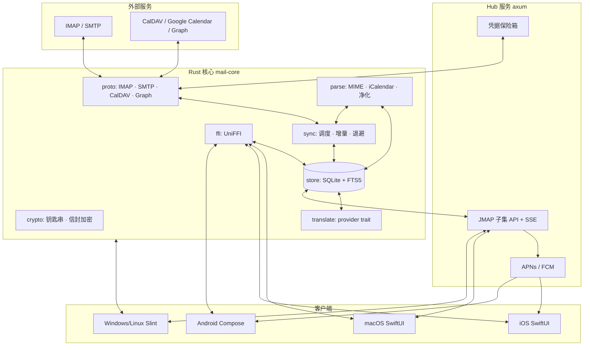
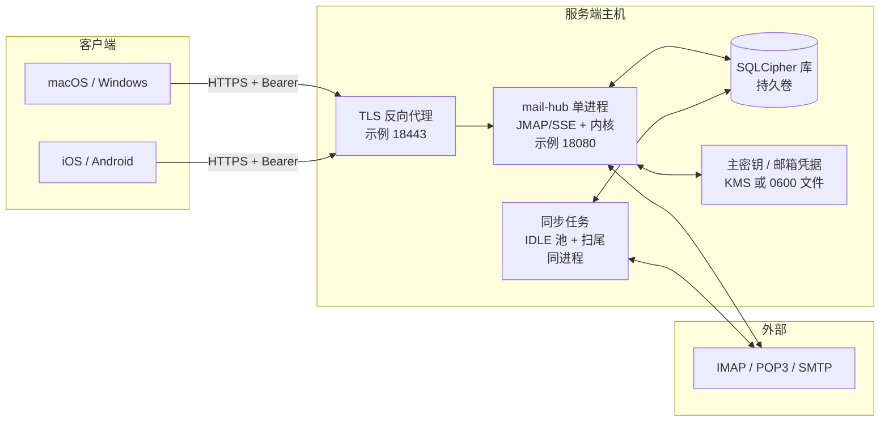

# Eyrie — 统一收件箱与日历客户端架构设计

状态：设计定稿；同步内核已实现（见 docs/IMPLEMENTATION.md）
许可：AGPL-3.0
日期：2026-10-28

---

## 1. 目标与非目标

### 目标
- 一个程序管理多个邮箱账户，统一收件箱、统一日历。
- 四端：macOS、Windows、iOS、Android。
- 两种部署：单机直连（桌面）与 Hub 模式（手机、跨设备一致）。
- 翻译：按需、可离线、可自托管。
- 体积小、常驻内存低、空闲 CPU 接近零。
- 代码边界清晰，可长期维护。

### 非目标（永久不做，不是"以后再说"）
- 端到端加密邮箱（Proton、Tuta 等不开放 IMAP，无法接入）。
- 服务端邮件托管（我们不是 MX，不做收信投递）。
- AI 写作助手（只预留 provider 接口，不内置模型）。
- 联系人同步（CardDAV 不在产品范围内）。

---

## 2. 决策记录（ADR）

| # | 决策 | 理由 | 代价 |
|---|---|---|---|
| D1 | 核心用 Rust，单份代码被四端调用 | 无 GC、内存可预测、交叉编译、IMAP/MIME/加密生态完整 | 团队需要 Rust 能力 |
| D2 | UI 按平台：SwiftUI（macOS/iOS）、Slint（Windows/Linux 桌面）、Compose（Android） | 内存与 CPU 优先；Windows/Linux 共用一套纯 Rust UI，桌面端不引入 CLR 或 WebView 框架 | 3 套 UI 代码；Slint 的中文输入法、无障碍与 WebView2 嵌入需 Windows 真机验证 |
| D3 | 客户端与 Hub 之间用 JMAP 子集（RFC 8620/8621） | 增量同步、状态字符串、SSE 推送已有标准语义，不自创协议 | JSON 体积略大，需要实现子集 |
| D4 | 桌面支持"本地直连"与"连 Hub"两种模式，共用同一核心 | 隐私与多端一致各取所需；手机端只做薄客户端 | 核心需抽象 provider |
| D5 | 存储统一 SQLite + FTS5（SQLCipher 加密） | 单文件、事务、全文检索、可跨平台打包 | 并发写需串行化 |
| D6 | 邮件统一走 IMAP/POP3 + SMTP，不接 Gmail API / Graph | 规避 restricted scope 与 CASA 年审 | 失去部分 Gmail 专有能力 |
| D7 | 日历走 CalDAV / Google Calendar API / Microsoft Graph | 微软不提供 CalDAV，必须 Graph | 三套日历适配器 |
| D8 | AGPL-3.0 | 自托管产品防闭源白嫖；与 GPL-3 代码可组合 | 商业客户敏感 |
| D9 | 组件策略：优先平台官方与成熟库，只有同步状态机与 HTML 净化自研 | 减少自研面，降低长期维护成本 | 依赖较多，需做许可与维护状态审查 |
| D10 | 首发平台 macOS + Windows（同一里程碑，先后实现） | 覆盖主要桌面用户 | 移动端与 Linux 延后 |
| D11 | Windows 桌面 UI 用 Slint（纯 Rust，单进程直连 `mail-core`），与 Linux 共用一套 UI；不再先做 WinUI 3 | WinUI 3 空闲 110–160 MB（同类业务应用实测约 155 MB），.NET 运行时本身 40–60 MB，与低内存目标冲突；MDM 在 Windows 用 egui 实测 70 MB 私有工作集（含显卡驱动共享约 120 MB、托盘 <10 MB），证明纯 Rust UI 可达标；Slint 与 D12 合并后桌面端只需一套 UI | 中文输入法、UIA 无障碍、WebView2 子窗口嵌入需真机验证；Windows 开发机需 Rust MSVC 工具链 |
| D12 | Linux 与 Windows 桌面 UI 共用 Slint（纯 Rust，单进程直连 `mail-core`） | 无 CLR / WebView 框架 / GTK / Qt 运行时依赖；内存与启动开销可控；macOS 上即可编译运行同一份代码，验证不受 Linux 机器限制；Windows 由 Rust 直接调用核心，不需要 UniFFI | 两平台共享 `.slint` 与视图模型，平台差异集中在 `src/platform/`；Slint 控件外观与 Windows 原生有差距，中文输入法与无障碍需实测 |
| D13 | 客户端首次运行选择"本地模式"或"远程模式"；远程模式只填服务端地址 + 设备令牌，邮箱凭据只留在服务端；客户端缓存列表元数据与已打开的正文/附件，可随时清除；服务端地址必须 HTTPS（回环例外） | 把 D4 落成可操作的产品形态：远程模式不接触邮箱密码，缓存可丢弃重建；正文不全量落客户端 | 客户端需要 JMAP 适配层与独立缓存；服务端提交端点与令牌按账户授权已实现；HTTPS 与后台同步仍待部署 |

---

## 3. 架构总览



### 3.1 两种运行形态（D4 / D13）

- **本地模式（桌面默认）**：Slint 桌面（Windows/Linux）以同进程 Rust 调用 `mail-core`；Apple 与 Android 经 UniFFI 调用同一核心。核心直连 IMAP/CalDAV；邮箱凭据存客户端钥匙串。首次运行的默认选项。
- **远程模式（Hub）**：核心在服务端运行，客户端通过 JMAP 子集读写；客户端只保存 Hub 地址与设备令牌，不保存邮箱密码，也不直连 IMAP/SMTP。手机只支持此模式。

远程模式的客户端约定：

- 首次运行必须选择模式；设置中可切换，但两种模式使用不同数据目录，切换不迁移缓存。
- 本地缓存只保存列表所需的元数据（id、邮箱、标志、主题、发件人、时间、大小、线程）与用户打开过的正文/附件；不主动拉取全量正文。**列表可全量缓存，正文/附件按需。**
- 提供"清除缓存"：删除本地缓存并重新从 Hub 拉取，服务端数据与凭据不受影响；清缓存后首次列表允许有加载态。
- 写操作（已读/标志/移动/导入/删除）走 JMAP；撰写与发送由服务端提交端点承担，端点落地前远程模式隐藏撰写入口。
- 服务端地址只接受 `https://`（本机回环 `http://127.0.0.1` 例外）；设备令牌存系统钥匙串。
- 令牌按账户授权：Session 与所有 method 只返回该设备可见的账户，不暴露同库其他账户。
- 远程模式不提供"添加邮箱账户"入口；账户的新增、删除与凭据维护属于服务端。

### 3.2 远程模式部署分布（推荐）

最小可靠分布是"每用户一份 Hub 实例 + 独立加密库"，HTTP 与内核同进程，TLS 由前置代理终止：



分布原则：

- **客户端**只保存服务端地址与设备令牌；地址含端口（示例 `https://host:18443`），远程模式不直连 IMAP/SMTP。
- **Hub 单进程**：HTTP API、内核、后台同步任务在同一进程；不要拆成两个进程共享一个 SQLite 文件。后台同步已实现（每账户 `watch_account`：IDLE 池 + 扫尾，`EYRIE_HUB_SYNC` 可关），库不再依赖外部 `mail-cli sync` 更新。
- **每用户一份**：一个 Hub 实例、一个 SQLCipher 库、一个持久卷。多用户不共用一个库 + 全权令牌；配对时把设备令牌绑定到单个账户（`hub_devices.account_id`），Session 与所有 JMAP 方法只在该账户内生效。
- **主密钥与库分开放**：库放持久卷，主密钥/邮箱凭据放 KMS 或 0600 文件；分开备份，主密钥丢失则数据不可恢复。
- **容器密钥后端**：无头容器通常没有系统钥匙串；服务端使用文件后端（`EYRIE_HUB_SECRET_DIR`，0600 文件，主密钥与账户密码同目录）或由部署注入主密钥（`EYRIE_HUB_MASTER_KEY_FILE`），不依赖系统钥匙串。开发期同名的 `EYRIE_DEV_SECRET_DIR` 仍被接受。
- **网络**：Hub 只绑定回环或容器网络，对外只暴露 TLS 入口；SSE 需关闭代理缓冲，读超时大于 `ping` 间隔。
- **推送**：桌面用 SSE；手机后续由 Hub 转 APNs/FCM，载荷只含"有新变更"。

| 场景 | 分布 | 说明 |
|---|---|---|
| 个人自用 | 1 台主机：1 个 Hub 容器 + TLS 反代 + 1 个卷 | 最小可用；补同步任务后即可 |
| 家庭/小团队 | 每用户 1 个 Hub 容器 + 独立库；反代按子域名/端口路由 | 隔离最干净 |
| 不建议 | 单库多用户 + 所有设备同一全权令牌 | 任意设备可读全部账户 |
| 不要做 | 远端模式下客户端同时直连 IMAP/SMTP | 绕过服务端，凭据边界失效 |

端口约定（默认标准端口，全部可覆盖）：

| 用途 | 默认端口 | 覆盖方式 |
|---|---|---|
| TLS 入口（反向代理） | `443` | 反代站点配置（`listen`/`TLS_PORT`）；Hub 若内置 TLS，使用 `EYRIE_HUB_TLS_BIND` |
| Hub 内部 HTTP | `8080` | `EYRIE_HUB_BIND=host:port`（当前实现） |
| 客户端连接地址 | 随服务端 | 首次运行/设置中的"服务端地址"自带端口（如 `https://host:18443`） |
| 邮箱接入（IMAP/POP3/SMTP） | 993/995/465（TLS）或 143/110/587 | 账户设置、CLI `--port`/`--smtp-port`；预设只提供默认值 |
| 开发用 SMTP sink | `1025` | sink 启动参数或环境变量（如 `SMTP_SINK_PORT`） |
| Dovecot 测试容器 | 容器内 `143` | `docker run -p ${DOVECOT_PORT:-31143}:143`，应用侧 `--port` 同步修改 |
| 可选指标端点 | `9090` | 指标服务配置（如 `METRICS_PORT`） |

- 任何新增监听端口都必须提供环境变量或配置项覆盖，代码只给默认值，不能把端口写死。
- 默认端口被占用时用覆盖值（例如 Hub `18080`、TLS `18443`），不改代码常量。
- 部署前用 `lsof -nP -iTCP:<port> -sTCP:LISTEN` 现查占用。

远程模式上线前置（缺一不可；✅ 已实现）：

1. ✅ Hub 内置同步任务（每账户 `watch_account`：IDLE 池 + 扫尾）。
2. TLS 终止（反代或 Hub 内置 rustls）。
3. ✅ 服务端密钥后端（文件后端 + 主密钥注入）与备份说明。
4. ✅ 令牌绑定账户，Session 只返回该设备可见账户（`hub_devices.account_id`，方法级 `accountId` 校验）。
5. ✅ 发送提交端点（`Identity/get` + `EmailSubmission/set`，客户端上传 RFC 822，服务端负责 SMTP 与 Sent 归档）。
6. ✅ `/healthz`；DB 快照备份、日志脱敏仍待补。
7. ✅ Hub 镜像（仓库根 `Dockerfile`）；部署脚本仍待补。

---

## 4. 仓库结构

```
.
├── Cargo.toml                  # workspace
├── crates/
│   ├── mail-core/              # 门面：组装各模块，暴露用例
│   ├── mail-proto/             # 协议适配器（imap/pop3/smtp/caldav/graph/google）
│   ├── mail-parse/             # MIME、iCalendar、HTML 净化、线程化
│   ├── mail-store/             # schema、迁移、查询、变更日志
│   ├── mail-sync/              # 同步状态机、调度、重试
│   ├── mail-crypto/            # 钥匙串、信封加密、随机数
│   ├── mail-translate/         # provider trait 与缓存
│   ├── mail-ffi/               # UniFFI 定义与绑定生成
│   ├── mail-api/               # JMAP 子集（服务端与本地共用）
│   ├── mail-hub/               # 服务端二进制
├── apps/                       # 各平台 UI 一律放这里，不混进 crates/
│   ├── macos/                  # SwiftUI
│   ├── desktop/                # Slint（Windows/Linux 共用，workspace 成员）
│   ├── ios/                    # SwiftUI
│   └── android/                # Kotlin + Compose
├── docs/
└── tests/
    ├── conformance/            # IMAP/CalDAV 兼容矩阵
    └── corpus/                 # 匿名化邮件样本
```

依赖方向（单向，禁止反向）：

```
mail-core → mail-sync → mail-proto, mail-parse（仅头部解码）
         → mail-store → (sqlite)
         → mail-parse
         → mail-crypto
         → mail-translate
mail-ffi → mail-core, mail-parse
apps/desktop → mail-core
mail-api → mail-store
mail-hub → mail-api, mail-core
```

`mail-parse` 不得依赖网络；`mail-store` 不得依赖 UI；`mail-api` 不得依赖 IMAP 类型；
`apps/desktop` 是唯一允许引入 Slint 的 workspace 成员；Windows 与 Linux 共用 `.slint`
与视图模型，平台差异集中在 `src/platform/{windows,linux}.rs`。其余 crate 不得依赖 UI
工具链；桌面 UI 与移动 UI 一样只通过门面（`mail-core`；Apple/Android 经 `mail-ffi`）访问核心。

---

## 5. 数据模型（SQLite）

关键表与字段（省略索引与审计列）：

```sql
-- 账户：凭据不落库，只存钥匙串引用
CREATE TABLE accounts (
  id            INTEGER PRIMARY KEY,
  provider      TEXT NOT NULL,          -- imap | gmail | graph
  email         TEXT NOT NULL,
  display_name  TEXT,
  secret_ref    TEXT NOT NULL,          -- 钥匙串 key，不存令牌本身
  settings      TEXT NOT NULL DEFAULT '{}',
  created_at    INTEGER NOT NULL
);

-- 邮箱/文件夹
CREATE TABLE mailboxes (
  id             INTEGER PRIMARY KEY,
  account_id     INTEGER NOT NULL REFERENCES accounts(id) ON DELETE CASCADE,
  remote_name    TEXT NOT NULL,
  role           TEXT,                  -- inbox|sent|drafts|trash|archive|spam
  uidvalidity    INTEGER,
  uidnext        INTEGER,
  highest_modseq INTEGER,
  last_sync_at   INTEGER,
  UNIQUE (account_id, remote_name)
);

-- 邮件主体（一封邮件一行，与所在文件夹解耦）
CREATE TABLE messages (
  id            INTEGER PRIMARY KEY,
  account_id    INTEGER NOT NULL,
  message_id    TEXT,                   -- RFC 5322 Message-ID
  thread_id     TEXT,                   -- 线程根：父邮件的 thread_id，否则自身 Message-ID
  in_reply_to   TEXT,                   -- RFC 5322 In-Reply-To，入线程时使用
  subject       TEXT,
  from_json     TEXT NOT NULL,
  to_json       TEXT NOT NULL,
  cc_json       TEXT,
  sent_at       INTEGER,
  size          INTEGER,
  snippet       TEXT,
  has_attach    INTEGER NOT NULL DEFAULT 0,
  body_state    TEXT NOT NULL DEFAULT 'headers'  -- headers|partial|full
);

-- 邮件在文件夹中的位置（Gmail 标签 = 多行）
CREATE TABLE message_locations (
  message_id  INTEGER NOT NULL REFERENCES messages(id) ON DELETE CASCADE,
  mailbox_id  INTEGER NOT NULL REFERENCES mailboxes(id) ON DELETE CASCADE,
  uid         INTEGER NOT NULL,
  flags       TEXT NOT NULL DEFAULT '[]',
  PRIMARY KEY (message_id, mailbox_id)
);

-- 内容寻址的正文与附件；同一份字节只存一行，引用计数归零才回收
CREATE TABLE blobs (
  hash        BLOB PRIMARY KEY,         -- sha256
  size        INTEGER NOT NULL,
  encoding    TEXT NOT NULL,            -- zstd|identity（当前实现只写 identity）
  refcount    INTEGER NOT NULL DEFAULT 1,
  data        BLOB NOT NULL
);

-- 正文部件：已按传输编码解码为 UTF-8，HTML 已净化后才入库
CREATE TABLE message_parts (
  message_id   INTEGER NOT NULL REFERENCES messages(id) ON DELETE CASCADE,
  part         TEXT NOT NULL,           -- IMAP section 路径；POP3 用 text/html 两个固定键
  content_type TEXT NOT NULL,
  charset      TEXT,
  is_html      INTEGER NOT NULL DEFAULT 0,
  blob_hash    BLOB,
  PRIMARY KEY (message_id, part)
);

-- Hub 上传但尚未被消息引用的字节；一天未使用即回收
CREATE TABLE uploads (
  account_id   INTEGER NOT NULL REFERENCES accounts(id) ON DELETE CASCADE,
  hash         BLOB NOT NULL,           -- 指向 blobs.hash
  content_type TEXT NOT NULL,
  size         INTEGER NOT NULL,
  created_at   INTEGER NOT NULL,
  PRIMARY KEY (account_id, hash)
);

-- 附件元数据；blob_hash 为空表示尚未按需下载
CREATE TABLE attachments (
  message_id   INTEGER NOT NULL REFERENCES messages(id) ON DELETE CASCADE,
  part         TEXT NOT NULL,
  filename     TEXT,
  content_type TEXT NOT NULL,
  encoding     TEXT,                    -- base64|quoted-printable|...，下载时用于解码
  size         INTEGER NOT NULL DEFAULT 0,
  blob_hash    BLOB,
  PRIMARY KEY (message_id, part)
);

-- 变更日志：增量同步的来源，超过阈值后被快照取代
CREATE TABLE changes (
  seq         INTEGER PRIMARY KEY AUTOINCREMENT,
  account_id  INTEGER NOT NULL,
  entity_type TEXT NOT NULL,            -- message|mailbox|calendar|event|settings
  entity_id   TEXT NOT NULL,
  op          TEXT NOT NULL,            -- created|updated|destroyed
  at          INTEGER NOT NULL
);

-- 每账户一份全量状态快照；seq 即其覆盖到的水位。游标早于该水位
-- （或早于最旧保留的 change）时必须重新全量加载，等价于 cannotCalculateChanges
CREATE TABLE change_snapshots (
  account_id  INTEGER PRIMARY KEY,
  seq         INTEGER NOT NULL,
  created_at  INTEGER NOT NULL,
  state       BLOB NOT NULL             -- JSON：mailboxes + messages + locations/flags
);

-- Hub 配对设备：只存令牌哈希，令牌本体只在配对响应里出现一次
CREATE TABLE hub_devices (
  id           INTEGER PRIMARY KEY,
  name         TEXT NOT NULL,
  token_hash   TEXT NOT NULL UNIQUE,
  created_at   INTEGER NOT NULL,
  last_seen_at INTEGER
);

-- 日历
CREATE TABLE calendars (
  id          TEXT PRIMARY KEY,
  account_id  TEXT NOT NULL,
  remote_url  TEXT,
  name        TEXT,
  color       TEXT,
  ctag        TEXT,
  sync_token  TEXT,
  last_sync_at INTEGER
);

CREATE TABLE events (
  id           TEXT PRIMARY KEY,
  calendar_id  TEXT NOT NULL REFERENCES calendars(id) ON DELETE CASCADE,
  uid          TEXT NOT NULL,           -- iCalendar UID
  ics          BLOB NOT NULL,           -- 原始 VEVENT，内容寻址
  summary      TEXT,
  dtstart_utc  INTEGER,
  dtend_utc    INTEGER,
  tzid         TEXT,
  rrule        TEXT,
  status       TEXT,
  sequence     INTEGER DEFAULT 0,
  etag         TEXT,
  UNIQUE (calendar_id, uid)
);

-- 重复事件的单次例外（RECURRENCE-ID）
CREATE TABLE event_overrides (
  event_id       TEXT NOT NULL REFERENCES events(id) ON DELETE CASCADE,
  recurrence_id  TEXT NOT NULL,
  ics            BLOB NOT NULL,
  cancelled      INTEGER NOT NULL DEFAULT 0,
  PRIMARY KEY (event_id, recurrence_id)
);

CREATE TABLE attendees (
  event_id  TEXT NOT NULL,
  email     TEXT NOT NULL,
  partstat  TEXT NOT NULL,              -- NEEDS-ACTION|ACCEPTED|DECLINED|TENTATIVE
  role      TEXT,
  PRIMARY KEY (event_id, email)
);

CREATE TABLE reminders (
  id        TEXT PRIMARY KEY,
  event_id  TEXT NOT NULL,
  offset_s  INTEGER NOT NULL,           -- 相对开始时间
  method    TEXT NOT NULL DEFAULT 'display'
);

-- 发件箱：定时发送与失败重试
CREATE TABLE outbox (
  id          TEXT PRIMARY KEY,
  account_id  TEXT NOT NULL,
  payload     BLOB NOT NULL,
  send_at     INTEGER NOT NULL,
  attempts    INTEGER NOT NULL DEFAULT 0,
  status      TEXT NOT NULL DEFAULT 'pending'
);

-- 翻译缓存
CREATE TABLE translations (
  key         TEXT PRIMARY KEY,         -- sha256(text+lang+provider+version)
  source_lang TEXT,
  target_lang TEXT NOT NULL,
  provider    TEXT NOT NULL,
  body        BLOB NOT NULL
);
```

FTS5：

```sql
CREATE VIRTUAL TABLE message_fts USING fts5(
  subject, from_text, to_text, body_text,
  content='', tokenize='trigram'         -- trigram 以支持中文子串检索
);
```

规则：
- 正文与附件只在 `blobs` 中存一份，`messages` 只存元数据。
- 删除账户为级联删除；`blobs` 用引用计数回收。
- 任何正文进入 FTS 前必须已完成 MIME 解码与 HTML 转纯文本。

---

## 6. 同步模型

### 6.1 邮件

每个 `mailbox` 维护游标 `(uidvalidity, uidnext, highest_modseq)`。

实测能力差异很大（见 `docs/SPIKE-REPORT.md` §2.2），因此同步必须按三档实现：

| 档 | 服务器 | 增量方式 | 实时性 | 移动操作 |
|---|---|---|---|---|
| A | Dovecot、Fastmail、Cyrus | `CHANGEDSINCE` + `VANISHED`（QRESYNC） | IDLE | `MOVE` |
| B | Outlook/M365、Yahoo | `UID FETCH <uidnext>:*`；标志位每 15 分钟全量对账 | IDLE | `MOVE` |
| C | iCloud | 同上，但无 IDLE | 60 s 轮询 | `COPY` + `\Deleted` + `EXPUNGE`（无 MOVE） |

```
连接
  → CAPABILITY 探测并缓存到账户配置
  → SELECT（A 档用 SELECT (CONDSTORE)）
  → 若 uidvalidity 变化：整箱重建
  → 按档位执行增量（见上表）
  → 持久化 → 写 changes 表 → 通知 API
  → A/B 档进入 IDLE（INBOX 常驻，其余按需）；C 档定时轮询
```

- C 档（iCloud）若要接近实时，需实现 Apple 私有 `XAPPLEPUSHSERVICE`，依赖 APNs 证书，暂不纳入。
- 断线：指数退避 1s→2s→…→5min，带抖动。
- 新邮件：先存头部与 BODYSTRUCTURE，正文按需拉取（`partial` → `full`）。
- 发送：SMTP 提交成功后才写 `\Sent`（或按服务器规则 APPEND）。
- 草稿：APPEND 到 Drafts，UID 变化时替换而非追加，避免重复。
- 错误分类：认证失败（停止并提示）、限流（退避）、协议错误（记录并跳过该邮箱）。

### 6.2 日历

- CalDAV：`PROPFIND` 取 `sync-token`/`CTag`，`REPORT sync-collection` 取增量，`PUT`/`DELETE` 写回，`If-Match` 做乐观锁。
- Google：Calendar API `syncToken` + `events.list`，`events.insert/patch/delete`。
- Microsoft：Graph `deltaLink` + `/me/events/delta`，写回 `/me/events`。
- 重复事件不展开存储；查询时按视图窗口展开（默认前后 3 个月），时区由 `jiff` 处理。
- 邀请函：解析 `.ics` 附件 → 生成待办 → 用户点击后更新 `attendees.partstat` → 回信（iMIP）或写回远端。

### 6.3 客户端增量协议（JMAP 子集）

端点：

| 方法 | 路径 | 说明 |
|---|---|---|
| GET | `/.well-known/jmap` | Session 对象（需 Bearer 设备令牌） |
| POST | `/jmap` | JMAP 请求体：`{using, methodCalls}` |
| POST | `/pair` | 用配对码换取设备令牌（只返回一次） |
| GET | `/eventsource/` | SSE 状态变更（`types`、`closeafter`、`ping`） |
| POST | `/upload/{accountId}` | 上传字节（`message/rfc822` 等），返回内容寻址 `blobId`；24 h 未引用即回收 |
| GET | `/download/{accountId}/{blobId}/{name}` | 正文/附件下载（blobId 为缓存散列 hex） |

已实现的 method：`Mailbox/get`、`Mailbox/changes`、`Email/query`、`Email/get`、
`Email/changes`、`Email/set`（`keywords`/`mailboxIds` 更新、`create`、`destroy`）、
`Email/import`、`Thread/get`、`Thread/changes`；
其余（`Core/echo`、日历与身份）返回 `unknownMethod`。
客户端不在支持范围内的筛选/排序条件返回 `unsupportedFilter` /
`unsupportedSort`，不做静默忽略。

认证：配对码换 32 字节随机令牌，库中只存 SHA-256 哈希；每次请求校验
`Authorization: Bearer <token>` 并更新 `last_seen_at`。

状态字符串是账户内的变更水位（十进制 `seq`）。客户端持有旧 state 调
`Email/changes` 拿增量；游标早于快照水位或早于最旧保留的 `changes` 行时返回
`cannotCalculateChanges`，客户端降级全量刷新。正文值（`bodyValues`）只在
客户端请求 `fetchTextBodyValues`/`fetchHTMLBodyValues` 时返回；未缓存的部分
由 Hub 经 `mail-core` 按需拉取，不返回空正文冒充成功。

本地库的变更日志有界：超过 `change_log_max_rows`（默认 20,000）后，`compact_changes` 在当前水位写一份全量快照并删除被覆盖的 `changes` 行。水位（`latest_change_seq`）取快照 seq 与剩余 `changes` 最大 seq 的较大值，因此压缩不会让状态字符串倒退；早于最旧保留行的游标由 `change_window` 识别并要求重载快照。state 按实体类型区分（mailbox/message/thread），`Email/set` 的 `ifInState` 只与 message 类型水位比较。

客户端缓存（远程模式）：

- 列表页只读本地缓存：元数据来自 `Email/query` + `Email/get` 的精简字段，按邮箱/时间窗口缓存，允许全量元数据。
- 每类对象单独保存 state；收到 `cannotCalculateChanges` 时清空该类型的缓存并全量重载，不阻塞其他类型。
- 正文/附件只在用户打开或导出时拉取并缓存；"清除缓存"删除缓存目录并清空 state，下次进入重新拉取，服务端数据不变。
- 缓存大小与时间窗口由客户端设置；达上限时先淘汰未打开过的正文/附件，再淘汰旧元数据。

推送：SSE 事件只携带 `{type, state}`，不含正文。Hub 侧已实现 SSE；手机端由 Hub 转
APNs/FCM 静默推送（载荷只含"有新变更"）尚未实现，等待推送凭据。

---

## 7. 安全基线

| 面 | 要求 |
|---|---|
| 传输 | TLS 1.2+（rustls），自建 Hub 可选 SPKI pinning |
| 认证 | OAuth2 + PKCE；SMTP/IMAP 用 SASL；Hub 设备令牌 32 字节随机，只存哈希 |
| 凭据 | 系统钥匙串（Keychain / Credential Manager / Keystore）；内存 `zeroize` |
| 客户端凭据边界 | 本地模式：邮箱密码只进客户端钥匙串；远程模式：客户端只存 Hub 地址与设备令牌，邮箱密码只在服务端保险箱，客户端不落盘、不写日志 |
| 客户端缓存 | 仅元数据与已打开内容；与服务端库分离；一键清除；清除只影响本地，不触发服务端删除 |
| 服务端保险箱 | 每账户 DEK，KEK 来自 KMS/env；XChaCha20-Poly1305；轮换流程写入 runbook |
| 本地库 | SQLCipher（`bundled-sqlcipher-vendored-openssl`）；主密钥存钥匙串，库密钥由它经 HKDF-SHA256 派生；FTS 索引随库加密；明文旧库拒绝打开；主密钥可导出/导入做人工恢复 |
| 邮件 HTML | 核心侧 `ammonia` 白名单净化；图片默认全阻断，仅放行 `cid:` 与光栅 data URI（含相对路径与 `srcset`）；UI 侧禁用 JS 的沙箱 WebView；CSP `default-src 'none'` |
| 远程内容 | 默认阻断；放行时经 Hub 代理，剥离 Referer 与追踪参数 |
| 附件 | 字节存加密库的 `blobs`（内容寻址，按需下载）；导出/打开时落到隔离目录，可执行类型拦截，不做自动打开 |
| 日志 | 不记录正文、地址、令牌；只记录 id 前缀与错误码 |
| 更新 | 平台签名 + 制品哈希校验 |
| Hub 暴露面 | 仅 HTTPS、限流、登录失败锁定、设备吊销列表、审计日志 |

明确披露：Hub 模式下服务器持有明文邮件；这是产品定位，不是缺陷。默认单机模式不经过任何服务器。

---

## 8. 翻译

```rust
#[async_trait]
pub trait Translator: Send + Sync {
    fn id(&self) -> &'static str;
    async fn translate(&self, req: TranslateRequest) -> Result<Translated>;
}
```

- 实现：`AppleTranslation`（macOS/iOS 17.4+）、`MlKit`（Android）、
  `LibreTranslate`（自托管 HTTP）、`OpenAiCompat`（本地 Ollama / 兼容端点）、`CloudApi`（用户自带 key）。
- 输入：净化后的纯文本段落，按 8KB 分批。
- 缓存键：`sha256(normalized_text | source_lang | target_lang | provider | model_version)`。
- UI 三态：原文 / 译文 / 双语；永不改写原文。
- 默认关闭；首次触发显示隐私提示；附件不参与翻译。

---

## 9. 性能预算与验证

| 指标 | 目标 | 门槛 |
|---|---|---|
| 安装包（桌面） | ≤ 25 MB | 超出则排查依赖 |
| 冷启动 | ≤ 1.5 s | 首帧 |
| 空闲内存 | macOS ≤ 120 MB；Windows ≤ 100 MB（Slint 主进程） | 私有工作集；WebView2 子进程单列 |
| 读信内存 | 单个 WebView2 实例 ≤ 150 MB | 池化 1 个，切走即释放 |
| 空闲 CPU | ≤ 0.5% | IDLE/SSE，无轮询 |
| 列表滚动 | 10 万封 ≥ 55 fps | 回收复用行 |
| 搜索 | P95 ≤ 150 ms | 10 万封，FTS5 |
| FFI 往返 | ≤ 1 ms/次，单次批量 ≤ 200 条 | 禁止逐行调用 |
| 增量同步 | ≤ 2 s 端到端 | Hub 推送 |

Windows 目标从 160 MB 下调到 100 MB：WinUI 3 的 .NET/XAML 运行时本身占 40–60 MB，常规实现下限约 155 MB；Slint 是纯 Rust 单进程，不需要 CLR。WebView2 只在打开正文时存在，按子进程单独计量，不计入 UI 主进程。依据与验证门槛见 §15。

---

## 10. 测试策略

- **解析**：500 封真实匿名邮件黄金样本，`insta` 快照；fuzz 目标覆盖 MIME 与 iCalendar。
- **IMAP 兼容**：Docker 起 GreenMail + Dovecot；真实账户矩阵（Gmail、Outlook、iCloud、Fastmail、自建），记录能力与行为差异。
- **日历**：RRULE 属性测试（含夏令时边界、月末、闰年）；邀请函状态机测试。
- **协议**：JMAP 子集用录制/回放 + 状态机不变量（`seq` 单调、`changes` 可重放）。
- **性能**：criterion 基准进 CI，超出预算即失败。
- **安全**：`cargo deny` 许可白名单；HTML 净化用例集；依赖漏洞扫描。
- **UI**：各平台最小快照测试，重点覆盖空态、错误态、超大列表。

CI 门禁：`fmt`、`clippy -D warnings`、`test`、`deny`、`bench`、产物体积检查。

---

## 11. Spike 计划（2 周，只验证假设）

| # | 假设 | 方法 | 通过标准 |
|---|---|---|---|
| S1 | Rust 能稳定覆盖主流 IMAP 行为 | 连接 5 类账户，跑增量同步与 IDLE | 无卡死/丢信，10k 封同步 < 60s |
| S2 | macOS SwiftUI 能撑住 10 万封列表 | UniFFI 分页 + NSTableView | 滚动 ≥ 55 fps，内存 ≤ 120 MB |
| S3 | Windows 能用 Slint 直连 Rust 核心 | `apps/desktop` 空壳 + 10 万行虚拟列表 | 私有工作集 ≤ 100 MB，空闲 CPU ≤ 0.5%，滚动 ≥ 55 fps |
| S4 | HTML 邮件可安全渲染 | 净化 + JS 禁用 WebView + 追踪像素拦截 | 无脚本执行，无外部请求 |
| S5 | 日历重复规则正确 | 20 组刁钻 RRULE + 时区用例 | 与 Google Calendar 展开结果一致 |

实测结果见 `docs/SPIKE-REPORT.md`。任一不通过，按下列顺序降级：S3 失败 → 退回 egui（MDM 已验证）；若仍不达标且产品接受 150 MB 级内存，再评估 WinUI 3。S2 失败 → 列表分页粒度改小并复用行。S1 失败 → 自写 IMAP 连接层（基于 `imap-proto`）。

---

## 12. 交付范围与建设顺序

### 12.1 一次交付的完整范围（不分版本）

产品发布时必须全部具备，缺一项即未完成：

**邮件**
- 多账户（IMAP/SMTP；Gmail/Outlook 用应用密码或用户自带 OAuth client）
- 统一收件箱 + 分账户视图、会话线程、星标/归档/删除/移动、草稿、未读计数
- 撰写/回复/转发（HTML + 纯文本）、多签名、附件上传与预览
- 全文搜索（本地 FTS5）与条件搜索（发件人/主题/附件/日期）
- 离线缓存、断线重连、错误恢复
- 系统通知与快速操作

**日历**
- 月/周/日/议程视图、多账户合并、颜色区分
- 新建/编辑/删除、全天事件、地点、备注
- 重复事件（含单次例外与取消）、时区正确、跨时区显示
- 邀请函收发（接受/拒绝/暂定）、参会人状态
- 提醒（本地通知 + 服务端推送）
- 系统日历桥（EventKit / CalendarContract）与直连（CalDAV / Google / Graph）

**翻译**
- 按需翻译，原文/译文/双语三态，结果缓存
- 本地（Apple Translation / ML Kit）、自托管（LibreTranslate / Ollama）、云 API（用户自带 key）

**Hub**
- 自托管部署（单二进制 + SQLite/Postgres）
- 设备配对与吊销、JMAP 子集同步、SSE 推送、APNs/FCM
- 服务端定时发送、跨设备状态一致

**四端一致**
- macOS / Windows / iOS / Android 功能对齐
- 深浅色、键盘快捷键、无障碍、中文输入法
- 自动更新、崩溃上报、日志脱敏

### 12.2 建设顺序（工程顺序，不是版本切分）

1. 地基：workspace、CI、SQLite schema、凭据保险箱、UniFFI 骨架
2. 同步：IMAP/SMTP 适配 + 变更日志 + 冲突处理
3. 桌面壳：macOS 接通（列表/阅读/写信/搜索），Windows 复用同一核心
4. 日历：系统桥 + CalDAV/Google/Graph + 邀请函
5. Hub：JMAP 子集 + 设备配对 + 推送 + 部署；远程模式前置：HTTPS、发送提交端点、令牌按账户授权
6. 客户端双模式：首次运行选择、远程 JMAP 适配层、独立缓存与清除
7. 移动：iOS/Android 薄客户端 + 后台同步 + 推送

顺序只表示依赖关系：前一项的接口稳定后才能并行下一项。任何一项都必须自带压测与故障注入，禁止"先堆功能后补质量"。

### 12.3 完成定义

- 五类邮箱（Gmail、Outlook、iCloud、Fastmail、自建）兼容矩阵全绿
- 四端各自达到 §9 的性能预算
- 安全清单逐项通过（§7），HTML 净化用例集无遗漏
- 断网、限流、令牌过期、服务器返回畸形数据四类故障可恢复
- 日历重复规则与时区用例与 Google Calendar 展开结果一致
- 夏令时空洞时间（如 02:00 被跳过）在写入前完成归一化

### 12.4 时间

单人全职到四端齐全：**18–24 个月**（含开工前 2 周验证）。该数字由三套原生 UI 与日历双通道的工程量推得，属估算，验证后校准。

若只有业余时间投入，按每周 15 小时折算约需 3 年以上。这个量级必须在动工前接受。

---

## 13. 组件清单（优先成熟件）

原则：能用平台官方或长期维护的库，就不自己写。只有两块没有成熟替代品，必须自研——IMAP 同步状态机、邮件 HTML 净化策略。这两块也正是产品壁垒。

### 13.1 客户端 UI

| 功能 | macOS / iOS | Windows | Android |
|---|---|---|---|
| 基础控件 | SwiftUI + AppKit（NSTableView / NSOutlineView / NSTextView） | Slint std-widgets + 少量自绘（纯 Rust，无 CLR） | Jetpack Compose + Material 3（LazyColumn） |
| 长列表（10 万封） | NSDiffableDataSource + 行复用 | Slint `ListView` + Rust 模型只持有当前页（50 条） | LazyColumn + key 复用 |
| 富文本撰写 | NSTextView / UITextView（attributed string） | Slint `TextEdit`（先纯文本；富文本编辑器待选型） | Compose Rich Editor（`com.github.MohamedRejeb.Compose-Rich-Editor`） |
| 邮件正文渲染 | WKWebView（禁用 JS） | WebView2（禁用脚本、池化 1 个、切走释放） | WebView（禁用 JS） |
| 通知 | UNUserNotificationCenter | Windows Toast（`windows` crate） | NotificationManager |
| 钥匙串 | Security.framework | keyring（Windows Credential Manager） | Android Keystore |
| OAuth 浏览器 | ASWebAuthenticationSession | 系统浏览器 + 回环回调 | Custom Tabs |
| 自动更新 | Sparkle | 安装器 + 发布签名校验（MSIX/WiX 待定） | Play 商店 |
| 崩溃上报 | Sentry Cocoa | Sentry Rust（待定） | Sentry Android |
| 测试 | XCTest | Rust 单测 + Slint 快照（待定） | JUnit |

### 13.2 核心与服务端

| 能力 | 采用 | 备注 |
|---|---|---|
| IMAP | `async-imap`（Delta Chat 维护） | QRESYNC / X-GM-EXT 需自补，已在 Spike S1 验证 |
| SMTP | `lettre` | 支持 STARTTLS、XOAUTH2、DKIM 签名 |
| MIME | `mail-parser`（Stalwart） | 快、容错强 |
| HTML 净化 | `ammonia` | 白名单策略由我们定义 |
| iCalendar | `icalendar` | 解析/生成 VEVENT |
| 重复规则 | `rrule` | RFC 5545 |
| 时间与时区 | `jiff` | 夏令时与 IANA 时区 |
| 数据库 | `rusqlite`（bundled-sqlcipher-vendored-openssl） | 加密 + FTS5；库密钥由钥匙串主密钥 HKDF 派生 |
| HTTP | `reqwest` + `rustls` | 统一 TLS 栈 |
| OAuth2 | `oauth2` | PKCE |
| 加密 | `chacha20poly1305`、`argon2`、`zeroize`、`keyring` | |
| 服务端 | `axum` + `tokio` + `sqlx` + `tower` | |
| 可观测 | `tracing` + `opentelemetry` | |
| 测试 | `insta`、`proptest`、`criterion` | 快照 / 属性 / 基准 |
| 语言标识 | `whatlang` | 离线，体积小 |

### 13.3 已知"看着成熟、其实有坑"的组件

| 组件 | 问题 | 处理 |
|---|---|---|
| 三端富文本编辑器 | 行为与产出的 HTML 不一致 | 只支持有限格式（粗体/斜体/列表/链接/引用/签名），统一导出 HTML 后由核心再净化 |
| `async-imap` | 扩展支持不全 | 封装层补齐 IDLE 重连、QRESYNC 降级；不可用时用 `imap-proto` 自写 |
| WebView 渲染邮件 | 内存最贵 | 单条消息一个实例，离屏池化复用，切走即释放 |
| 各平台日历接口 | 能力差异大 | 见 §14，桥接层 + 直连协议双实现 |

---

## 14. 日历接入方式

目标：既能读写系统日历，也能直接连账户。做一个 `CalendarProvider` trait，三种实现并存。

| 平台 | 系统接口 | 能做什么 | 不能做什么 |
|---|---|---|---|
| macOS / iOS | EventKit | 读写用户在系统设置中已登录的 iCloud / Google / Exchange 日历；事件双向出现在系统日历 App | **参会人只读**，无法通过 EventKit 邀请；拿不到自定义属性；需用户授权 |
| Android | CalendarContract | 读写系统内全部日历账户；事件、参会人、提醒、RRULE 均可写 | 发送邀请依赖账户的同步适配器；Google 专有字段需 extras |
| Windows | 无公共系统日历接口 | 只能直连 Microsoft Graph 或 CalDAV | 系统"日历"应用不开放 API；经典 Outlook 的 COM/MAPI 脆弱且依赖已安装 |

实现策略：

1. **Apple**：默认 `EventKitProvider`。用户无需重新登录，日历立即可用；若账户未配置在系统中，回退 `CalDavProvider` / `GoogleCalendarProvider`。
2. **Android**：默认 `CalendarContractProvider`，回退同上。
3. **Windows**：`GraphProvider`（Microsoft 365）或 `CalDavProvider`；不提供 Outlook COM 方案。
4. **邀请函**：EventKit 无法邀请参会人，统一走 iMIP（把 `.ics` 当邮件发出）或 Graph/CalDAV 的 scheduling 扩展。
5. **Hub 模式**：服务器不依赖系统日历，必须直连 CalDAV/Google/Graph；否则多端日历不一致。桌面本地模式可只用系统桥。

代价：EventKit 提供的是"系统视图"，复杂重复规则可能被系统归一化；因此事件必须以原始 `.ics` 为准存档，UI 展示以桥接层为准。

---

## 15. Windows UI 栈与内存路线

结论（D11）：Windows 与 Linux 共用 Slint（纯 Rust，`apps/desktop`），不采用 WinUI 3。

### 15.1 依据

- WinUI 3 的空闲内存有一层 CLR/XAML 运行时成本：同类业务应用实测约 155 MB，WPF 约 185 MB；.NET 运行时本身 40–60 MB。即便 Native AOT，预期也只到 90–130 MB，且 AOT 仍受限。
- 纯 Rust UI 的 Windows 实测：MDM（egui/eframe）窗口打开、无下载时约 70 MB 私有工作集，含显卡驱动共享约 120 MB；托盘 <10 MB；程序 38 MB；发布 86 种语言。它证明 Rust UI + GPU 渲染 + 系统字体在 Windows 上可以长期发布。
- Slint 与 egui 同属纯 Rust；Slint 是保留模式声明式 UI，文本选择、输入法、无障碍与表格虚拟化不需要像 egui 那样全部自绘。Siskin 没有维护 egui/winit fork 的预算。
- Windows/Linux 共用一套 `.slint` 与视图模型后，桌面 UI 从两套变一套，也不再需要 C# / `uniffi-bindgen-cs`。

| 方案 | 预期空闲内存 | 工期（相对 WinUI 3） | 结论 |
|---|---|---|---|
| WinUI 3 + .NET | 110–160 MB（同类实测约 155） | 基准 | 放弃 |
| WinUI 3 + Native AOT | 90–130 MB | +3~4 周 | 放弃：仍高于目标，AOT 受限 |
| C++/WinRT | 50–90 MB | +3~4 个月 | 不做：C++ 内存安全与边界成本 |
| **Rust + Slint** | **50–90 MB（待实测）** | **+2~3 个月** | **采用（D11/D12）** |
| Rust + egui（参照） | 约 70 MB（MDM 实测） | 需自绘全部控件 | 备选：Slint 验证失败时的退路 |

### 15.2 内存账

- **UI 主进程**：Slint + 布局 + 当前页 50 条元数据，目标 ≤100 MB 私有工作集。
- **WebView2**：只在打开正文时创建，池化 1 个，禁用 JS 与外部资源；切走即释放。按 `msedgewebview2.exe` 子进程单独计量，目标单实例 ≤150 MB。
- **核心**：SQLCipher 连接与分页查询在 UI 进程内，沿用 §9 预算；不因 UI 栈变化。

### 15.3 验收门槛（Windows 11 真机，Spike S3）

1. 空壳 + 10 万封虚拟列表：私有工作集 ≤100 MB；空闲 CPU ≤0.5%（60 s 平均）；冷启动首帧 ≤1.5 s；滚动 ≥55 fps。
2. 单封 HTML 正文（WebView2，JS 关闭）：主进程增量 ≤30 MB；`msedgewebview2.exe` 全部子进程 ≤150 MB；关闭阅读后回落到基线。
3. 中文输入法（微软拼音）、Narrator/UIA、高 DPI 125/150/200%、剪贴板与文本选择。
4. Slint 渲染后端：Windows 默认后端启动成功；失败时可回退且不崩溃；空闲 CPU 达标。
5. 测量脚本：`powershell -NoProfile -ExecutionPolicy Bypass -File spike/scripts/measure-windows-process.ps1`（私有工作集、工作集、CPU、WebView2 子进程）。

实测（2026-11-10，`apps/desktop`）：私有工作集 5.59 MB、空闲 CPU 0.0%、首窗 63–80 ms、10 万行离屏渲染 258.8 fps、WebView2 84.05 MB、UIA 树可用。方法、命令与未验证项见 `docs/SPIKE-REPORT.md` §10。

### 15.4 风险与未验证

- Slint 在 Windows 的 WebView2 子窗口嵌入、UIA 树与内存/CPU 已在真机通过 S3；微软拼音组合、Narrator 实际朗读、125/150/200% DPI、剪贴板与文本选择仍未人工验收。
- WebView2 由 `wry`（MIT/Apache-2.0，仅 `apps/desktop`、仅 Windows 目标）托管；Linux 的 HTML 阅读需要另行验证 WebKitGTK 路径，不在 S3 范围。
- Slint 的 GPL-3.0 与 AGPL-3.0 组合可用（AGPL §13），仍需在依赖政策中登记并核对具体版本。
- Windows 开发构建必须签名：未签名 exe 从 Explorer 启动会触发 Windows 的“未知发布者”提示，进程挂起等待放行；使用 `spike/scripts/build-windows-ui.ps1` 构建并签名。发布给用户的包必须用受信任的代码签名证书；见 `docs/HANDOFF.md` §6.1/§11。
- 若 Slint 在 S3 任一项不达标，退回 egui（MDM 已验证），不回 WinUI 3。
