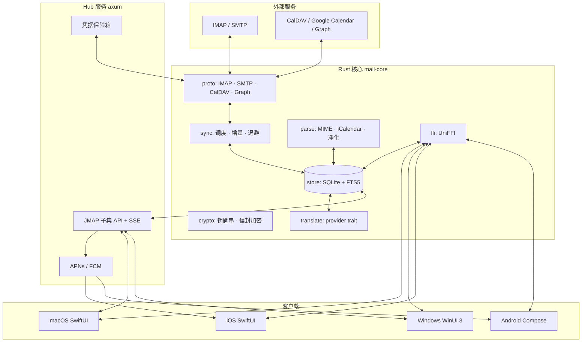

# Eyrie — 统一收件箱与日历客户端架构设计

状态：设计定稿；同步内核已实现（见 docs/IMPLEMENTATION.md）
许可：AGPL-3.0
日期：2026-10-28

---

## 1. 目标与非目标

### 目标
- 一个程序管理多个邮箱账户，统一收件箱、统一日历。
- 四端：macOS、Windows、iOS、Android。
- 两种部署：单机直连（桌面）与 Hub 模式（手机、跨设备一致）。
- 翻译：按需、可离线、可自托管。
- 体积小、常驻内存低、空闲 CPU 接近零。
- 代码边界清晰，可长期维护。

### 非目标（永久不做，不是"以后再说"）
- 端到端加密邮箱（Proton、Tuta 等不开放 IMAP，无法接入）。
- 服务端邮件托管（我们不是 MX，不做收信投递）。
- AI 写作助手（只预留 provider 接口，不内置模型）。
- 联系人同步（CardDAV 不在产品范围内）。

---

## 2. 决策记录（ADR）

| # | 决策 | 理由 | 代价 |
|---|---|---|---|
| D1 | 核心用 Rust，单份代码被四端调用 | 无 GC、内存可预测、交叉编译、IMAP/MIME/加密生态完整 | 团队需要 Rust 能力 |
| D2 | UI 全部原生（SwiftUI / WinUI 3 / Compose） | 内存与手感优先，接受多套 UI | 3 套 UI 代码，工期约翻倍 |
| D3 | 客户端与 Hub 之间用 JMAP 子集（RFC 8620/8621） | 增量同步、状态字符串、SSE 推送已有标准语义，不自创协议 | JSON 体积略大，需要实现子集 |
| D4 | 桌面支持"本地直连"与"连 Hub"两种模式，共用同一核心 | 隐私与多端一致各取所需；手机端只做薄客户端 | 核心需抽象 provider |
| D5 | 存储统一 SQLite + FTS5（SQLCipher 加密） | 单文件、事务、全文检索、可跨平台打包 | 并发写需串行化 |
| D6 | 邮件统一走 IMAP/SMTP，不接 Gmail API / Graph | 规避 restricted scope 与 CASA 年审 | 失去部分 Gmail 专有能力 |
| D7 | 日历走 CalDAV / Google Calendar API / Microsoft Graph | 微软不提供 CalDAV，必须 Graph | 三套日历适配器 |
| D8 | AGPL-3.0 | 自托管产品防闭源白嫖；与 GPL-3 代码可组合 | 商业客户敏感 |

---

## 3. 架构总览



两种运行形态：

- **本地模式（桌面默认）**：UI 通过 UniFFI 调用进程内核心，核心直连 IMAP/CalDAV。
- **Hub 模式**：核心在服务器上运行，客户端通过 JMAP 子集同步；手机只支持此模式。

---

## 4. 仓库结构

```
.
├── Cargo.toml                  # workspace
├── crates/
│   ├── mail-core/              # 门面：组装各模块，暴露用例
│   ├── mail-proto/             # 协议适配器（imap/smtp/caldav/graph/google）
│   ├── mail-parse/             # MIME、iCalendar、HTML 净化、线程化
│   ├── mail-store/             # schema、迁移、查询、变更日志
│   ├── mail-sync/              # 同步状态机、调度、重试
│   ├── mail-crypto/            # 钥匙串、信封加密、随机数
│   ├── mail-translate/         # provider trait 与缓存
│   ├── mail-ffi/               # UniFFI 定义与绑定生成
│   ├── mail-api/               # JMAP 子集（服务端与本地共用）
│   └── mail-hub/               # 服务端二进制
├── apps/
│   ├── macos/                  # SwiftUI
│   ├── windows/                # WinUI 3 + C#
│   ├── ios/                    # SwiftUI
│   └── android/                # Kotlin + Compose
├── docs/
└── tests/
    ├── conformance/            # IMAP/CalDAV 兼容矩阵
    └── corpus/                 # 匿名化邮件样本
```

依赖方向（单向，禁止反向）：

```
mail-core → mail-sync → mail-proto
         → mail-store → (sqlite)
         → mail-parse
         → mail-crypto
         → mail-translate
mail-ffi → mail-core
mail-api → mail-store
mail-hub → mail-api, mail-core
```

`mail-parse` 不得依赖网络；`mail-store` 不得依赖 UI；`mail-api` 不得依赖 IMAP 类型。

---

## 5. 数据模型（SQLite）

关键表与字段（省略索引与审计列）：

```sql
-- 账户：凭据不落库，只存钥匙串引用
CREATE TABLE accounts (
  id            TEXT PRIMARY KEY,
  provider      TEXT NOT NULL,          -- imap | gmail | graph
  email         TEXT NOT NULL,
  display_name  TEXT,
  secret_ref    TEXT NOT NULL,          -- 钥匙串 key，不存令牌本身
  settings      TEXT NOT NULL DEFAULT '{}',
  created_at    INTEGER NOT NULL
);

-- 邮箱/文件夹
CREATE TABLE mailboxes (
  id             TEXT PRIMARY KEY,
  account_id     TEXT NOT NULL REFERENCES accounts(id) ON DELETE CASCADE,
  remote_name    TEXT NOT NULL,
  role           TEXT,                  -- inbox|sent|drafts|trash|archive|spam
  uidvalidity    INTEGER,
  uidnext        INTEGER,
  highest_modseq INTEGER,
  last_sync_at   INTEGER,
  UNIQUE (account_id, remote_name)
);

-- 邮件主体（一封邮件一行，与所在文件夹解耦）
CREATE TABLE messages (
  id            TEXT PRIMARY KEY,
  account_id    TEXT NOT NULL,
  message_id    TEXT,                   -- RFC 5322 Message-ID
  thread_id     TEXT,
  subject       TEXT,
  from_json     TEXT NOT NULL,
  to_json       TEXT NOT NULL,
  cc_json       TEXT,
  sent_at       INTEGER,
  size          INTEGER,
  snippet       TEXT,
  has_attach    INTEGER NOT NULL DEFAULT 0,
  body_state    TEXT NOT NULL DEFAULT 'headers'  -- headers|partial|full
);

-- 邮件在文件夹中的位置（Gmail 标签 = 多行）
CREATE TABLE message_locations (
  message_id  TEXT NOT NULL REFERENCES messages(id) ON DELETE CASCADE,
  mailbox_id  TEXT NOT NULL REFERENCES mailboxes(id) ON DELETE CASCADE,
  uid         INTEGER NOT NULL,
  flags       TEXT NOT NULL DEFAULT '[]',
  PRIMARY KEY (message_id, mailbox_id)
);

-- 内容寻址的正文与附件
CREATE TABLE blobs (
  hash        BLOB PRIMARY KEY,         -- sha256
  size        INTEGER NOT NULL,
  encoding    TEXT NOT NULL,            -- zstd|identity
  refcount    INTEGER NOT NULL DEFAULT 1
);

-- 变更日志：客户端增量同步的唯一来源
CREATE TABLE changes (
  seq         INTEGER PRIMARY KEY AUTOINCREMENT,
  account_id  TEXT NOT NULL,
  entity_type TEXT NOT NULL,            -- message|mailbox|calendar|event|settings
  entity_id   TEXT NOT NULL,
  op          TEXT NOT NULL,            -- created|updated|destroyed
  at          INTEGER NOT NULL
);

-- 日历
CREATE TABLE calendars (
  id          TEXT PRIMARY KEY,
  account_id  TEXT NOT NULL,
  remote_url  TEXT,
  name        TEXT,
  color       TEXT,
  ctag        TEXT,
  sync_token  TEXT,
  last_sync_at INTEGER
);

CREATE TABLE events (
  id           TEXT PRIMARY KEY,
  calendar_id  TEXT NOT NULL REFERENCES calendars(id) ON DELETE CASCADE,
  uid          TEXT NOT NULL,           -- iCalendar UID
  ics          BLOB NOT NULL,           -- 原始 VEVENT，内容寻址
  summary      TEXT,
  dtstart_utc  INTEGER,
  dtend_utc    INTEGER,
  tzid         TEXT,
  rrule        TEXT,
  status       TEXT,
  sequence     INTEGER DEFAULT 0,
  etag         TEXT,
  UNIQUE (calendar_id, uid)
);

-- 重复事件的单次例外（RECURRENCE-ID）
CREATE TABLE event_overrides (
  event_id       TEXT NOT NULL REFERENCES events(id) ON DELETE CASCADE,
  recurrence_id  TEXT NOT NULL,
  ics            BLOB NOT NULL,
  cancelled      INTEGER NOT NULL DEFAULT 0,
  PRIMARY KEY (event_id, recurrence_id)
);

CREATE TABLE attendees (
  event_id  TEXT NOT NULL,
  email     TEXT NOT NULL,
  partstat  TEXT NOT NULL,              -- NEEDS-ACTION|ACCEPTED|DECLINED|TENTATIVE
  role      TEXT,
  PRIMARY KEY (event_id, email)
);

CREATE TABLE reminders (
  id        TEXT PRIMARY KEY,
  event_id  TEXT NOT NULL,
  offset_s  INTEGER NOT NULL,           -- 相对开始时间
  method    TEXT NOT NULL DEFAULT 'display'
);

-- 发件箱：定时发送与失败重试
CREATE TABLE outbox (
  id          TEXT PRIMARY KEY,
  account_id  TEXT NOT NULL,
  payload     BLOB NOT NULL,
  send_at     INTEGER NOT NULL,
  attempts    INTEGER NOT NULL DEFAULT 0,
  status      TEXT NOT NULL DEFAULT 'pending'
);

-- 翻译缓存
CREATE TABLE translations (
  key         TEXT PRIMARY KEY,         -- sha256(text+lang+provider+version)
  source_lang TEXT,
  target_lang TEXT NOT NULL,
  provider    TEXT NOT NULL,
  body        BLOB NOT NULL
);
```

FTS5：

```sql
CREATE VIRTUAL TABLE message_fts USING fts5(
  subject, from_text, to_text, body_text,
  content='', tokenize='trigram'         -- trigram 以支持中文子串检索
);
```

规则：
- 正文与附件只在 `blobs` 中存一份，`messages` 只存元数据。
- 删除账户为级联删除；`blobs` 用引用计数回收。
- 任何正文进入 FTS 前必须已完成 MIME 解码与 HTML 转纯文本。

---

## 6. 同步模型

### 6.1 邮件

每个 `mailbox` 维护游标 `(uidvalidity, uidnext, highest_modseq)`。

实测能力差异很大（见 `docs/SPIKE-REPORT.md` §2.2），因此同步必须按三档实现：

| 档 | 服务器 | 增量方式 | 实时性 | 移动操作 |
|---|---|---|---|---|
| A | Dovecot、Fastmail、Cyrus | `CHANGEDSINCE` + `VANISHED`（QRESYNC） | IDLE | `MOVE` |
| B | Outlook/M365、Yahoo | `UID FETCH <uidnext>:*`；标志位每 15 分钟全量对账 | IDLE | `MOVE` |
| C | iCloud | 同上，但无 IDLE | 60 s 轮询 | `COPY` + `\Deleted` + `EXPUNGE`（无 MOVE） |

```
连接
  → CAPABILITY 探测并缓存到账户配置
  → SELECT（A 档用 SELECT (CONDSTORE)）
  → 若 uidvalidity 变化：整箱重建
  → 按档位执行增量（见上表）
  → 持久化 → 写 changes 表 → 通知 API
  → A/B 档进入 IDLE（INBOX 常驻，其余按需）；C 档定时轮询
```

- C 档（iCloud）若要接近实时，需实现 Apple 私有 `XAPPLEPUSHSERVICE`，依赖 APNs 证书，暂不纳入。
- 断线：指数退避 1s→2s→…→5min，带抖动。
- 新邮件：先存头部与 BODYSTRUCTURE，正文按需拉取（`partial` → `full`）。
- 发送：SMTP 提交成功后才写 `\Sent`（或按服务器规则 APPEND）。
- 草稿：APPEND 到 Drafts，UID 变化时替换而非追加，避免重复。
- 错误分类：认证失败（停止并提示）、限流（退避）、协议错误（记录并跳过该邮箱）。

### 6.2 日历

- CalDAV：`PROPFIND` 取 `sync-token`/`CTag`，`REPORT sync-collection` 取增量，`PUT`/`DELETE` 写回，`If-Match` 做乐观锁。
- Google：Calendar API `syncToken` + `events.list`，`events.insert/patch/delete`。
- Microsoft：Graph `deltaLink` + `/me/events/delta`，写回 `/me/events`。
- 重复事件不展开存储；查询时按视图窗口展开（默认前后 3 个月），时区由 `jiff` 处理。
- 邀请函：解析 `.ics` 附件 → 生成待办 → 用户点击后更新 `attendees.partstat` → 回信（iMIP）或写回远端。

### 6.3 客户端增量协议（JMAP 子集）

端点：

| 方法 | 路径 | 说明 |
|---|---|---|
| POST | `/api` | JMAP 请求体：`{using, methodCalls}` |
| GET | `/eventsource?types=...` | SSE 推送状态变更 |
| POST | `/upload` | 附件上传 |
| GET | `/download/{blobId}/{name}` | 附件下载 |

实现的 method：
`Mailbox/get|changes`、`Email/query|get|changes|set|import`、`Thread/get`、
`Calendar/get|changes`、`CalendarEvent/query|get|changes|set`、`Identity/get`、`Core/echo`。

状态字符串格式：`<account_id>:<seq>`。客户端持有旧 state，调用 `/changes` 拿增量；服务端无法计算时返回 `cannotCalculateChanges`，客户端降级全量刷新。

推送：SSE 事件只携带 `{type, state}`，不含正文；手机端由 Hub 转 APNs/FCM 静默推送，载荷只含"有新变更"。

---

## 7. 安全基线

| 面 | 要求 |
|---|---|
| 传输 | TLS 1.2+（rustls），自建 Hub 可选 SPKI pinning |
| 认证 | OAuth2 + PKCE；SMTP/IMAP 用 SASL；Hub 设备令牌 32 字节随机，只存哈希 |
| 凭据 | 系统钥匙串（Keychain / Credential Manager / Keystore）；内存 `zeroize` |
| 服务端保险箱 | 每账户 DEK，KEK 来自 KMS/env；XChaCha20-Poly1305；轮换流程写入 runbook |
| 本地库 | SQLCipher（`bundled-sqlcipher-vendored-openssl`）；主密钥存钥匙串，库密钥由它经 HKDF-SHA256 派生；FTS 索引随库加密；明文旧库拒绝打开；主密钥可导出/导入做人工恢复 |
| 邮件 HTML | 核心侧 `ammonia` 白名单净化；图片默认全阻断，仅放行 `cid:` 与光栅 data URI（含相对路径与 `srcset`）；UI 侧禁用 JS 的沙箱 WebView；CSP `default-src 'none'` |
| 远程内容 | 默认阻断；放行时经 Hub 代理，剥离 Referer 与追踪参数 |
| 附件 | 隔离目录、按需下载、可执行类型拦截、不做自动打开 |
| 日志 | 不记录正文、地址、令牌；只记录 id 前缀与错误码 |
| 更新 | 平台签名 + 制品哈希校验 |
| Hub 暴露面 | 仅 HTTPS、限流、登录失败锁定、设备吊销列表、审计日志 |

明确披露：Hub 模式下服务器持有明文邮件；这是产品定位，不是缺陷。默认单机模式不经过任何服务器。

---

## 8. 翻译

```rust
#[async_trait]
pub trait Translator: Send + Sync {
    fn id(&self) -> &'static str;
    async fn translate(&self, req: TranslateRequest) -> Result<Translated>;
}
```

- 实现：`AppleTranslation`（macOS/iOS 17.4+）、`MlKit`（Android）、
  `LibreTranslate`（自托管 HTTP）、`OpenAiCompat`（本地 Ollama / 兼容端点）、`CloudApi`（用户自带 key）。
- 输入：净化后的纯文本段落，按 8KB 分批。
- 缓存键：`sha256(normalized_text | source_lang | target_lang | provider | model_version)`。
- UI 三态：原文 / 译文 / 双语；永不改写原文。
- 默认关闭；首次触发显示隐私提示；附件不参与翻译。

---

## 9. 性能预算与验证

| 指标 | 目标 | 门槛 |
|---|---|---|
| 安装包（桌面） | ≤ 25 MB | 超出则排查依赖 |
| 冷启动 | ≤ 1.5 s | 首帧 |
| 空闲内存 | macOS ≤ 120 MB；Windows ≤ 160 MB | 私有内存 |
| 空闲 CPU | ≤ 0.5% | IDLE/SSE，无轮询 |
| 列表滚动 | 10 万封 ≥ 55 fps | 回收复用行 |
| 搜索 | P95 ≤ 150 ms | 10 万封，FTS5 |
| FFI 往返 | ≤ 1 ms/次，单次批量 ≤ 200 条 | 禁止逐行调用 |
| 增量同步 | ≤ 2 s 端到端 | Hub 推送 |

Windows 的 .NET 运行时本身占 40–60 MB，160 MB 是常规实现的下限；更低内存的可行路线见 §15。

---

## 10. 测试策略

- **解析**：500 封真实匿名邮件黄金样本，`insta` 快照；fuzz 目标覆盖 MIME 与 iCalendar。
- **IMAP 兼容**：Docker 起 GreenMail + Dovecot；真实账户矩阵（Gmail、Outlook、iCloud、Fastmail、自建），记录能力与行为差异。
- **日历**：RRULE 属性测试（含夏令时边界、月末、闰年）；邀请函状态机测试。
- **协议**：JMAP 子集用录制/回放 + 状态机不变量（`seq` 单调、`changes` 可重放）。
- **性能**：criterion 基准进 CI，超出预算即失败。
- **安全**：`cargo deny` 许可白名单；HTML 净化用例集；依赖漏洞扫描。
- **UI**：各平台最小快照测试，重点覆盖空态、错误态、超大列表。

CI 门禁：`fmt`、`clippy -D warnings`、`test`、`deny`、`bench`、产物体积检查。

---

## 11. Spike 计划（2 周，只验证假设）

| # | 假设 | 方法 | 通过标准 |
|---|---|---|---|
| S1 | Rust 能稳定覆盖主流 IMAP 行为 | 连接 5 类账户，跑增量同步与 IDLE | 无卡死/丢信，10k 封同步 < 60s |
| S2 | macOS SwiftUI 能撑住 10 万封列表 | UniFFI 分页 + NSTableView | 滚动 ≥ 55 fps，内存 ≤ 120 MB |
| S3 | Windows 能用 UniFFI 调 Rust | `uniffi-bindgen-cs` + WinUI 3 空壳 | 调用成功，内存 ≤ 160 MB |
| S4 | HTML 邮件可安全渲染 | 净化 + JS 禁用 WebView + 追踪像素拦截 | 无脚本执行，无外部请求 |
| S5 | 日历重复规则正确 | 20 组刁钻 RRULE + 时区用例 | 与 Google Calendar 展开结果一致 |

实测结果见 `docs/SPIKE-REPORT.md`。任一不通过，按下列顺序降级：S3 失败 → Hub 走本地 HTTP/IPC；S2 失败 → 列表分页粒度改小并复用行；S1 失败 → 自写 IMAP 连接层（基于 `imap-proto`）。

---

## 12. 交付范围与建设顺序

### 12.1 一次交付的完整范围（不分版本）

产品发布时必须全部具备，缺一项即未完成：

**邮件**
- 多账户（IMAP/SMTP；Gmail/Outlook 用应用密码或用户自带 OAuth client）
- 统一收件箱 + 分账户视图、会话线程、星标/归档/删除/移动、草稿、未读计数
- 撰写/回复/转发（HTML + 纯文本）、多签名、附件上传与预览
- 全文搜索（本地 FTS5）与条件搜索（发件人/主题/附件/日期）
- 离线缓存、断线重连、错误恢复
- 系统通知与快速操作

**日历**
- 月/周/日/议程视图、多账户合并、颜色区分
- 新建/编辑/删除、全天事件、地点、备注
- 重复事件（含单次例外与取消）、时区正确、跨时区显示
- 邀请函收发（接受/拒绝/暂定）、参会人状态
- 提醒（本地通知 + 服务端推送）
- 系统日历桥（EventKit / CalendarContract）与直连（CalDAV / Google / Graph）

**翻译**
- 按需翻译，原文/译文/双语三态，结果缓存
- 本地（Apple Translation / ML Kit）、自托管（LibreTranslate / Ollama）、云 API（用户自带 key）

**Hub**
- 自托管部署（单二进制 + SQLite/Postgres）
- 设备配对与吊销、JMAP 子集同步、SSE 推送、APNs/FCM
- 服务端定时发送、跨设备状态一致

**四端一致**
- macOS / Windows / iOS / Android 功能对齐
- 深浅色、键盘快捷键、无障碍、中文输入法
- 自动更新、崩溃上报、日志脱敏

### 12.2 建设顺序（工程顺序，不是版本切分）

1. 地基：workspace、CI、SQLite schema、凭据保险箱、UniFFI 骨架
2. 同步：IMAP/SMTP 适配 + 变更日志 + 冲突处理
3. 桌面壳：macOS 接通（列表/阅读/写信/搜索），Windows 复用同一核心
4. 日历：系统桥 + CalDAV/Google/Graph + 邀请函
5. Hub：JMAP 子集 + 设备配对 + 推送 + 部署
6. 移动：iOS/Android 薄客户端 + 后台同步 + 推送

顺序只表示依赖关系：前一项的接口稳定后才能并行下一项。任何一项都必须自带压测与故障注入，禁止"先堆功能后补质量"。

### 12.3 完成定义

- 五类邮箱（Gmail、Outlook、iCloud、Fastmail、自建）兼容矩阵全绿
- 四端各自达到 §9 的性能预算
- 安全清单逐项通过（§7），HTML 净化用例集无遗漏
- 断网、限流、令牌过期、服务器返回畸形数据四类故障可恢复
- 日历重复规则与时区用例与 Google Calendar 展开结果一致
- 夏令时空洞时间（如 02:00 被跳过）在写入前完成归一化

### 12.4 时间

单人全职到四端齐全：**18–24 个月**（含开工前 2 周验证）。该数字由三套原生 UI 与日历双通道的工程量推得，属估算，验证后校准。

若只有业余时间投入，按每周 15 小时折算约需 3 年以上。这个量级必须在动工前接受。

---

## 13. 组件清单（优先成熟件）

原则：能用平台官方或长期维护的库，就不自己写。只有两块没有成熟替代品，必须自研——IMAP 同步状态机、邮件 HTML 净化策略。这两块也正是产品壁垒。

### 13.1 客户端 UI

| 功能 | macOS / iOS | Windows | Android |
|---|---|---|---|
| 基础控件 | SwiftUI + AppKit（NSTableView / NSOutlineView / NSTextView） | WinUI 3 + CommunityToolkit.WinUI（MVVM Toolkit、ItemsRepeater、SettingsCard） | Jetpack Compose + Material 3（LazyColumn） |
| 长列表（10 万封） | NSDiffableDataSource + 行复用 | ItemsRepeater + x:Bind 编译绑定 | LazyColumn + key 复用 |
| 富文本撰写 | NSTextView / UITextView（attributed string） | RichEditBox | Compose Rich Editor（`com.github.MohamedRejeb.Compose-Rich-Editor`） |
| 邮件正文渲染 | WKWebView（禁用 JS） | WebView2（禁用脚本、离屏池化） | WebView（禁用 JS） |
| 通知 | UNUserNotificationCenter | WinRT Toast | NotificationManager |
| 钥匙串 | Security.framework | Windows Credential Locker / DPAPI | Android Keystore |
| OAuth 浏览器 | ASWebAuthenticationSession | WebAuthenticationBroker | Custom Tabs |
| 自动更新 | Sparkle | MSIX + App Installer | Play 商店 |
| 崩溃上报 | Sentry Cocoa | Sentry .NET | Sentry Android |
| 测试 | XCTest | xUnit | JUnit |

### 13.2 核心与服务端

| 能力 | 采用 | 备注 |
|---|---|---|
| IMAP | `async-imap`（Delta Chat 维护） | QRESYNC / X-GM-EXT 需自补，已在 Spike S1 验证 |
| SMTP | `lettre` | 支持 STARTTLS、XOAUTH2、DKIM 签名 |
| MIME | `mail-parser`（Stalwart） | 快、容错强 |
| HTML 净化 | `ammonia` | 白名单策略由我们定义 |
| iCalendar | `icalendar` | 解析/生成 VEVENT |
| 重复规则 | `rrule` | RFC 5545 |
| 时间与时区 | `jiff` | 夏令时与 IANA 时区 |
| 数据库 | `rusqlite`（bundled-sqlcipher-vendored-openssl） | 加密 + FTS5；库密钥由钥匙串主密钥 HKDF 派生 |
| HTTP | `reqwest` + `rustls` | 统一 TLS 栈 |
| OAuth2 | `oauth2` | PKCE |
| 加密 | `chacha20poly1305`、`argon2`、`zeroize`、`keyring` | |
| 服务端 | `axum` + `tokio` + `sqlx` + `tower` | |
| 可观测 | `tracing` + `opentelemetry` | |
| 测试 | `insta`、`proptest`、`criterion` | 快照 / 属性 / 基准 |
| 语言标识 | `whatlang` | 离线，体积小 |

### 13.3 已知"看着成熟、其实有坑"的组件

| 组件 | 问题 | 处理 |
|---|---|---|
| 三端富文本编辑器 | 行为与产出的 HTML 不一致 | 只支持有限格式（粗体/斜体/列表/链接/引用/签名），统一导出 HTML 后由核心再净化 |
| `async-imap` | 扩展支持不全 | 封装层补齐 IDLE 重连、QRESYNC 降级；不可用时用 `imap-proto` 自写 |
| WebView 渲染邮件 | 内存最贵 | 单条消息一个实例，离屏池化复用，切走即释放 |
| 各平台日历接口 | 能力差异大 | 见 §14，桥接层 + 直连协议双实现 |

---

## 14. 日历接入方式

目标：既能读写系统日历，也能直接连账户。做一个 `CalendarProvider` trait，三种实现并存。

| 平台 | 系统接口 | 能做什么 | 不能做什么 |
|---|---|---|---|
| macOS / iOS | EventKit | 读写用户在系统设置中已登录的 iCloud / Google / Exchange 日历；事件双向出现在系统日历 App | **参会人只读**，无法通过 EventKit 邀请；拿不到自定义属性；需用户授权 |
| Android | CalendarContract | 读写系统内全部日历账户；事件、参会人、提醒、RRULE 均可写 | 发送邀请依赖账户的同步适配器；Google 专有字段需 extras |
| Windows | 无公共系统日历接口 | 只能直连 Microsoft Graph 或 CalDAV | 系统"日历"应用不开放 API；经典 Outlook 的 COM/MAPI 脆弱且依赖已安装 |

实现策略：

1. **Apple**：默认 `EventKitProvider`。用户无需重新登录，日历立即可用；若账户未配置在系统中，回退 `CalDavProvider` / `GoogleCalendarProvider`。
2. **Android**：默认 `CalendarContractProvider`，回退同上。
3. **Windows**：`GraphProvider`（Microsoft 365）或 `CalDavProvider`；不提供 Outlook COM 方案。
4. **邀请函**：EventKit 无法邀请参会人，统一走 iMIP（把 `.ics` 当邮件发出）或 Graph/CalDAV 的 scheduling 扩展。
5. **Hub 模式**：服务器不依赖系统日历，必须直连 CalDAV/Google/Graph；否则多端日历不一致。桌面本地模式可只用系统桥。

代价：EventKit 提供的是"系统视图"，复杂重复规则可能被系统归一化；因此事件必须以原始 `.ics` 为准存档，UI 展示以桥接层为准。

---

## 15. Windows 内存路线

现状：.NET XAML 应用的空闲内存有一层运行时成本，实测同类业务应用 WinUI 3 约 155 MB、WPF 约 185 MB。Native AOT 主要改善启动速度与体积，对工作集的削减视应用而定（微软官方措辞）。

| 方案 | 预期空闲内存 | 相对 WinUI 3 的工期增量 | 风险 |
|---|---|---|---|
| WinUI 3 + .NET（常规） | 110–160 MB | 基准 | 低 |
| WinUI 3 + Native AOT + 调优 | 90–130 MB | +3~4 周 | 中（AOT 仍为预览，反射受限） |
| C++/WinRT（无 CLR） | 50–90 MB | +3~4 个月 | 高（C++ 内存安全、跨语言边界） |
| Rust + Slint（与核心同语言） | 50–90 MB | +2~3 个月 | 中高（控件、无障碍、中文输入法需验证） |

调优清单（在任一方案下均适用）：

- 单进程；WebView2 不预加载，按需创建并池化 1–2 个实例。
- 所有列表用虚拟化容器，禁止把整表绑定到内存集合。
- 数据分页从核心取，单页 50 条，FFI 批量返回。
- 图片按显示尺寸解码；附件不预载。
- 关闭 Mica/Acrylic 与高开销动画（设置项可开）。
- 发布用 ReadyToRun 起步，AOT 作为可选通道验证后再切换。

决策建议：先用 WinUI 3 做到 110–130 MB，验证阶段实测；若不能接受，再在 Windows 客户端开工前整体切 C++/WinRT 或 Slint。**不要一开始就上 C++/WinRT**——那会把主要风险从"产品能否做成"变成"能否写完"。
