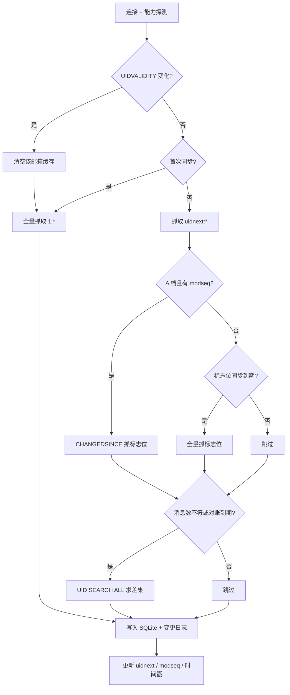
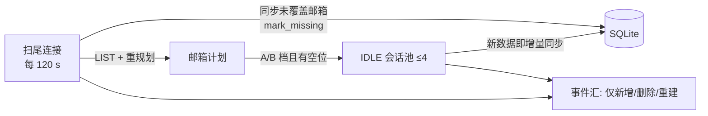

# 实现说明（同步内核 + 加密库 + 多协议 + 正文索引 + 多邮箱实时监听 + Hub + 桌面撰写）

日期：2026-11-06
范围：工程骨架、本地存储（SQLCipher 加密）、凭据保险箱、IMAP/POP3 接收、SMTP 发送（To/Cc/Bcc 与附件）、提供商预设、正文/附件按需拉取与 HTML 净化、正文全文索引（schema v6）、全账户多邮箱遍历与实时监听、本地回收站与保留期、Hub JMAP 子集（含上传、`Email/import`、`Thread/get`）、macOS 撰写与 `.app` 打包、开发 CLI
状态：协议路径已实测（Dovecot + 88 服务器 STARTTLS）；正文与附件、多邮箱、回收站、实时监听、正文搜索、撰写发送（Dovecot + 本地 SMTP sink）已实跑；真实账号收发未验收

---

## 1. 已交付

| crate | 职责 | 关键点 |
|---|---|---|
| `mail-crypto` | 凭据保险箱 + 信封加密 | 系统钥匙串（macOS Keychain / Windows Credential Manager / Linux Secret Service）；XChaCha20-Poly1305 带 AAD；主密钥首次使用时生成并存入钥匙串，HKDF-SHA256 派生用途子密钥 |
| `mail-store` | SQLite 存储（SQLCipher） | 账户、邮箱、消息、位置、变更日志、FTS5（主题/地址/摘要/正文）；内容寻址 `blobs` + 引用计数；`message_parts`/`attachments` 与 `body_state`；`body_text` 存前 4,000 字纯文本，FTS 行用 `rewrite_fts` 删+插重建（contentless 不能 UPDATE）；变更日志有界（`change_snapshots` 全量快照 + 压缩，水位不倒退）；WAL；schema v6 迁移（重建 FTS 并从 blob 回填正文）；UIDVALIDITY 重建；邮箱 `missing_at` 本地回收站与保留期清理；`settings` 表；打开时先验密钥，错密钥与明文旧库都显式报错 |
| `mail-parse` | MIME 解码与净化 | 传输编码（base64/quoted-printable）、charset（encoding_rs，含 GBK）、RFC 2047 文件名、ammonia 白名单净化、HTML→纯文本、整封 MIME 遍历（POP3 路径） |
| `mail-proto` | IMAP/POP3/SMTP 传输 | IMAP：TLS/STARTTLS/明文、能力探测、三档、UID 抓取、BODYSTRUCTURE + `BODY.PEEK` 分段取正文、IDLE、MOVE、RFC 6154 SPECIAL-USE、修改版 UTF-7 邮箱名；POP3：LIST/UIDL/TOP/RETR、STLS；SMTP：EHLO、STARTTLS、AUTH、DATA |
| `mail-sync` | 增量同步 | IMAP：首同步、UID/标志位增量、删除检测、UIDVALIDITY 重建、全账户遍历（跳过 `\Noselect`/`\All`/`\Flagged`）、消失邮箱转本地回收站；POP3：UIDL 镜像与轮询 |
| `mail-core` | 门面 | 账户添加、预设解析、IMAP/POP3 分派、`sync`/`sync_account`、`watch`（单邮箱）/`watch_account`（全邮箱：IDLE 池 + 扫尾连接，只推送真实变更；每轮同步后按阈值压缩变更日志）、`check`、`send`（SMTP + Sent 归档）、`fetch_body`（缓存优先，命中时补写正文索引）、`fetch_attachment`（按需）、回收站保留期设置与自动清理、`change_window`/`compact_changes` |
| `mail-cli` | 开发工具 | `add-account / check / send / accounts / sync / watch / mailboxes / list / search / trash / trash-purge / body / attachment / stats / retention / set-retention / changes / changes-compact / set-change-max-rows / export-key / import-key` |

产品 UI、Hub、日历、翻译不在本段范围内。

---

## 2. 同步流程



删除检测不再每次全量扫描：只有服务端 `EXISTS` 与本地条数不一致，或距上次对账超过 15 分钟，才执行 `UID SEARCH ALL`。实测把一次删除同步从 3.4 s 降到 69 ms。

### 2.1 常驻监听（`watch_account`）



- A/B 档（广告 IDLE）的邮箱各占一条连接，按 `plan_mailboxes` 顺序取前 `idle_sessions` 个（默认 4，`--idle-sessions 0` 即纯轮询）。
- 其余邮箱由扫尾连接轮询（`--sweep-seconds`，默认 120 s）；扫尾同时重新 LIST，新增邮箱补进计划、消失邮箱停掉 worker 并进回收站。
- 扫尾用 `sync_account_except` 跳过已有会话的邮箱，避免同一邮箱双写；跳过列表仍参与 `mark_missing_mailboxes`。
- 事件只在 `inserted + removed > 0` 或 `full`（新邮箱/UIDVALIDITY 重建）时发出：周期性全量标志位重扫会把每行都算成 `applied`，无法与真实变化区分。POP3 保持 60 s 轮询，同样只回调真实变更。
- 故障：连接断开按 1→2→4 s 退避（上限 60 s）重连；退出时直接丢弃 IDLE 连接（IDLE 中的会话无法退回）。

---

## 3. 协议、端口与安全

| 服务 | IMAP TLS | IMAP STARTTLS | POP3 TLS | POP3 STLS | SMTP TLS | SMTP STARTTLS |
|---|---|---|---|---|---|---|
| Gmail | 993 | 143 | 995 | 110 | 465 | 587 / 25 |
| QQ | 993 | 143（服务器不提供 STARTTLS） | 995 | 110（无 STLS） | 465 | 587 / 25 |
| 88 / 111 / email.cn | 993 | 143 | 995 | 110 | 465 | 587 / 25 |
| 自定义 | 用户指定 | 用户指定 | 用户指定 | 用户指定 | 用户指定 | 用户指定 |

- `--provider gmail|qq|88|custom` 决定主机；`--protocol imap|pop3` 决定接收协议；`--security tls|starttls|plaintext` 决定加密方式；`--port/--smtp-port` 可覆盖默认端口。
- 默认端口由协议与安全方式推导（IMAP 993/143、POP3 995/110、SMTP 465/587）。
- 明文必须显式开启：`--security plaintext` 或 `--smtp-security plaintext` 需要同时提供 `--insecure-plaintext true`，否则拒绝写入账户。
- QQ 的 143/110 不提供 STARTTLS/STLS，使用这两个端口即明文传授权码；文档与错误信息会提示改用 993/995。
- 发信：To/Cc/Bcc 三组收件人，Bcc 只写入 SMTP 信封、绝不写入报文头；正文为 UTF-8 base64；附件用 `multipart/mixed`（每封合计上限 25 MiB，超限直接失败不截断）。
- 头字段校验：主题/地址/附件名含控制字符即拒绝（防头注入）；地址只接受 `local@domain` 形式（不支持显示名与 SMTPUTF8）；非 ASCII 主题按 45 字节切成折叠的 RFC 2047 encoded-word，非 ASCII 附件名用单段 encoded-word（`mail-parse` 能解回）。
- SMTP 缺省：预设 provider 在 `Core::add_account` 时自动补 SMTP（465 隐式 TLS，用户名取接收用户名）；`custom` 必须显式给 SMTP，否则发送时报 `no SMTP settings`。
- 归档：IMAP 账户发送成功后尝试 `APPEND` 到 `Sent`（`--sent-mailbox` 可改），失败只报告 `save_error`，不回滚投递；POP3 无 Sent 归档。`APPEND` 的标志位必须以括号列表传入（`(\Seen)`），缺括号会让服务器拒绝并让客户端挂起。

---

## 4. 实测结果（Dovecot 2.3.19，10,000 封）

| 场景 | 结果 |
|---|---|
| 首次全量同步（release） | 10,002 封 / **1,005 ms**，数据库 5.1 MB |
| 加密库首次全量同步（release） | 10,003 封 / **612 ms**，数据库 5.7 MB |
| 加密库空闲增量 | **1 ms**（同步阶段） |
| 无密钥打开 | `sqlite3 … 'select count(*) from sqlite_master;'` → `file is not a database`（26）；`strings` 无主题命中 |
| 错密钥打开 | `StoreError::WrongKey`（单测覆盖） |
| 明文旧库打开 | `StoreError::PlaintextDatabase`（单测覆盖；CLI 实跑同结果） |
| 空闲增量（release） | **5 ms**（进程整体 38 ms） |
| 新邮件经 IDLE 到达并同步 | **43 ms**（含通知与写入） |
| 标志位变更（CHANGEDSINCE） | applied=1，无重复插入 |
| 外部删除一封 | removed=1，**69 ms** |
| UIDVALIDITY 重建 | 清空后全量 10,000 封 / 2,794 ms（debug 构建） |
| STARTTLS（88：IMAP 143 / POP3 110 / SMTP 587） | 升级后进入 AUTH，错误口令被拒 |
| POP3 同步（mock） | 2 封入库；UIDL 消失后 removed=1 |
| SMTP（mock） | AUTH PLAIN、MAIL/RCPT/DATA、点填充校验通过 |
| 撰写发送（Dovecot IMAP + 本地 SMTP sink，CLI） | `to/cc/bcc` 三个 RCPT；报文头只有 `To`/`Cc`，无 `Bcc`；`Sent` 3→4；附件 32 字节往返一致 |
| 撰写发送（`mail-ffi` 冒烟） | `sendRecipients=3 savedTo=Sent`；正文与附件在 Sent 中可回读 |
| IMAP `APPEND` 标志（mock） | 断言命令为 `APPEND "Sent" (\Seen) {n}`；修复前缺括号导致连接挂起 |
| 撰写校验 | 非法地址、含 `\r\n` 的主题均被拒绝；附件 25 MiB 上限单测覆盖 |
| 正文拉取（multipart/alternative + 附件，Dovecot） | 首次取正文 1 次连接，`state=partial`；附件下载后 `state=full` |
| 正文二次打开（服务器已停） | **39 ms** 进程整体，纯本地缓存命中 |
| 单部件消息（`BODY.PEEK[TEXT]`） | 正常取回，`state=full` |
| 附件按需下载（base64） | 解码后内容与原文一致；`blob_bytes` = 正文 + HTML + 附件之和 |
| 重同步后正文缓存 | 保留，`body_state` 不回退 |
| 全账户同步（debug，Dovecot） | LIST 6 个邮箱；INBOX 10,005 封 1,143 ms，Sent/项目 各 1 封 ≤14 ms；`\Sent`/`\Drafts`/`\Trash`/`\Junk` 角色映射正确 |
| 修改版 UTF-7 邮箱名 | LIST 的 `&mHl27g-` 解码为 `项目`；SELECT 时重新编码，同步成功 |
| 服务器删除邮箱 | 删 `项目` 后 sync：该行 `state=missing`，消息只在 `trash` 出现，`list` 不再返回 |
| 同名单重建 | 旧行改名为 `项目 (local trash 2)` 并保留消息，新 `项目` 全量同步；回收站内容未丢 |
| 保留期设置 | 默认 90 天；`set-retention --days 30` 后 `retention` 回读 30；`trash-purge` 未到期返回 0 |
| 多邮箱 watch（Dovecot 6 邮箱） | 非 INBOX（`项目`，IDLE 覆盖）投递后 ≤1 s 入库；`Sent`（扫尾覆盖，sweep 3 s）≤3 s；`--max-events 2` 收到 2 个真实事件后退出 |
| 多邮箱 watch：服务器重启 | 4 个 IDLE 会话同时断线，按 1/2/4 s 退避重连；恢复后新邮件正常入库 |
| 多邮箱 watch：邮箱删除 | worker 停止，无重复报错；该邮箱 `state=missing` |
| 全量同步（release，含 FTS 行重写） | 10,009 封 / **451 ms**，数据库 5.79 MB |
| 正文索引体积（10k 封，CJK 正文 ~3,800 字/封） | 仅正文缓存 124 MB；1,000 字/封索引 +50 MB；4,000 字/封 +160 MB |
| 正文索引查询（10k 封） | 命中全表的 3 字词 ~55 ms；中文 2 字 LIKE 52 ms（1,000 字/封）/ 137 ms（4,000 字/封）；选择性短语 0.1–0.3 ms |
| 正文搜索（Dovecot 端到端） | 拉取前搜 `zebraqilin` 无结果，`body` 后命中；中文 2 字 `营收` 经 LIKE 命中 |
| schema v5→v6 迁移 | 主题索引保留、正文从 blob 回填、`user_version=6`（单测） |
| 单测 | 141 个全绿（crypto/store/sync/proto/parse/core/api/hub/ffi/cli 组件） |

首次同步后进程启动有一次钥匙串授权检查（新二进制），之后的同步都在 40 ms 内。

---

## 5. 正文与附件

- 同步阶段只写头部，`body_state='headers'`；打开邮件时才拉正文，二次打开只读本地库。
- IMAP：`FETCH (UID BODYSTRUCTURE)` → 叶子部件按 `1`、`2.1` 编号 → 只对正文部件发 `BODY.PEEK[<section>]`（不置 `\Seen`）；附件留到用户点下载。
- POP3：无分段，`RETR` 整封 → `mail-parse` 遍历 MIME → 正文与附件一次入库。POP3 的正文部件键固定为 `text`/`html`，不伪装成 IMAP section。
- 解码：`mail-parse` 处理传输编码与 charset（含 GBK）；HTML 经 ammonia 白名单净化，`script/iframe/form/style` 移除，`url(...)` 与 `javascript:` 丢弃，远程图片改 `about:blank`，只放行 `cid:` 与光栅 data URI。
- 存储：`blobs` 按 sha256 内容寻址 + 引用计数；`message_parts` 存已解码 UTF-8 正文；`attachments` 存元数据（含传输编码），下载后回填 `blob_hash`；`body_state` 由 `refresh_body_state` 统一推导：`headers` → `partial` → `full`。
- 附件文件名统一取 basename、剥离控制字符、解码 RFC 2047、截断 255 字符；不自动打开（隔离目录导出待 UI 段）。

---

## 5.1 多邮箱遍历与本地回收站

- 遍历：`sync` 不带 `--mailbox` 时对 IMAP 账户执行 `LIST "" "*"`，跳过 `\Noselect`（层级占位）与虚拟邮箱 `\All`/`\Flagged`（Gmail 会聚合其他邮箱，同步会重复）；INBOX 永远排在最前，即使 LIST 缺失也会补同步。
- 角色：优先 RFC 6154 属性（`\Sent`/`\Drafts`/`\Trash`/`\Junk`/`\Archive`），没有属性才按名字回退（含 `INBOX.Sent`、`[Gmail]/Sent Mail` 与中文“已发送/草稿/已删除/垃圾邮件”）。角色只写 `mailboxes.role`，不改远程名。
- 名称编码：IMAP 线上邮箱名是修改版 UTF-7；`list_mailboxes` 解码成 UTF-8，`select`/`append`/`move_message` 负责重新编码。`INBOX` 是纯 ASCII，不受影响。
- 去重：同一封（Message-ID 相同）在多个邮箱里只保留一个 `messages` 行与多条 `message_locations`；`list/search/count` 取一个代表位置（`missing_at IS NULL` 的最小 `mailbox_id`），避免 INBOX 与 Archive 重复展示。
- 回收站：服务器不再列出的邮箱写 `mailboxes.missing_at`，其消息从正常列表、搜索、计数中隐藏，只在 `list_trash` 出现；取正文时优先仍在服务器上的位置。
- 保留期：`settings.trash_retention_days` 默认 90 天（1–3650 可设）；每次 `sync`/`sync_account` 先清理超过保留期的回收站，删除邮箱行、无位置的消息、正文/附件 blob 与 FTS 行。
- 同名单重建：删掉后又被重建的邮箱通常是新 UIDVALIDITY；先把旧行改名为 `<name> (local trash <id>)` 留在回收站，再给新同名邮箱建新行，避免重建时提前删掉旧消息。
- 单封邮件在服务器端消失仍按 UID 差集硬删除（服务器侧通常已移入 Trash 文件夹，随后同步到本地 Trash）；回收站保留期只作用于“整个邮箱消失”的数据。

---

## 5.2 Hub 与 JMAP 子集

- 分层：`mail-api` 只做 JMAP 语义（Session、请求/响应、错误映射），不依赖 HTTP；`mail-hub` 是 axum 二进制，负责配对、鉴权、路由与按需拉正文。依赖方向保持 `mail-hub → mail-api, mail-core`，`mail-api → mail-store`。
- 认证：配对码（`EYRIE_HUB_PAIRING_CODE`，未设置则每进程随机生成并打印一次）换 32 字节随机令牌；库中 `hub_devices` 只存 SHA-256 哈希与 `last_seen_at`，令牌只在配对响应里出现一次。
- 端点：`GET /.well-known/jmap`（Session）、`POST /jmap`、`POST /pair`、`GET /eventsource/`（SSE）、`GET /download/{accountId}/{blobId}/{name}`、`POST /upload/{accountId}`（带不带尾斜杠都路由）。上传按内容寻址写入 `blobs` + `uploads`，`maxSizeUpload` 50 MiB，`uploads` 行 24 小时未使用即回收（引用它的消息仍可读）。
- 已实现 method：`Mailbox/get`（角色映射、`totalEmails`/`unreadEmails`、`myRights` 随写入能力切换）、`Mailbox/changes`、`Email/query`（`inMailbox`、`text`、`hasKeyword`/`notKeyword` 的 `$seen`/`$flagged`、`before`/`after`、position/limit，`total` 与分页一致）、`Email/get`（`mailboxIds` 为全部在线位置并集、keywords 为位置并集、附件元数据与 `blobId`、`bodyValues`）、`Email/changes`、`Email/set`（只更新 `keywords` 与 `mailboxIds`；`create`/`destroy` 按对象返回 `notSupported`）、`Email/import`、`Thread/get`。
- `Email/import`：只接受本账户 `/upload` 产生的 blob（未知或他人 blob 返回 `blobNotFound`），每次导入一个邮箱、只支持已知关键字；Hub 用 `mail-core::import_message` 执行 `APPEND`（带关键字对应的标志），成功后同步该邮箱取得本地行，响应里的 `id`/`threadId` 就是本地消息；多邮箱与自定义关键字返回 `notSupported`。
- 线程：同步时把 `In-Reply-To` 写进 `messages.in_reply_to`，`thread_id` 取父邮件的线程根（父未到达时先以自身 `Message-ID` 为根，父到达后递归改挂整棵子树）；无 `Message-ID` 的消息线程 id 为 `t<id>`。`Thread/get` 只返回在线邮箱里的消息，`Email/get` 的 `threadId` 与它一致。
- 写路径：`mail-api::WriteSink` 由 Hub 用 `mail-core` 实现，保持 `mail-api → mail-store` 依赖方向。`$seen`/`$flagged`/`$answered`/`$draft`/`$forwarded` 映射为 IMAP 标志；先对每个在线位置 `STORE`，全部成功后才更新本地 flags 并写 `message updated`。移动只接受单副本消息，走 `MOVE` 或 `COPY+EXPUNGE`，随后同步目标邮箱取得新 UID、再删源位置；多副本返回 `notSupported`。
- 不支持的条件显式失败：其他 filter/sort 返回 `unsupportedFilter`/`unsupportedSort`，未知 method 返回 `unknownMethod`，不静默忽略。排序固定为 `receivedAt` 降序 + id 降序，单次查询上限 1,000 条。
- 变更语义：`apply_fetch` 写 `message created/updated/removed`，`ensure_mailbox` 写 `mailbox created/restored`；`Email/changes` 与 `Mailbox/changes` 共用游标规则但按 `entity_type` 过滤。同一窗口内创建后又删除的 id 不出现在任何列表，创建后又更新的 id 只出现在 `created`。游标早于快照水位或早于最旧 `changes` 行时返回 `cannotCalculateChanges`。
- 正文：`Email/get` 只在客户端请求 `fetchTextBodyValues`/`fetchHTMLBodyValues` 时返回 `bodyValues`；未缓存时通过 `mail_api::BodySource`（Hub 用 `mail-core::fetch_body`）按需拉取，失败返回 `serverFail` 而不是空正文。单部件消息的空 section 在 JMAP 层映射为 `text`/`html`。缓存后的正文/附件在 `blobId` 中暴露散列 hex，`/download` 只在 blob 属于该账户时返回字节。
- SSE：`types` 选 `Email`/`Mailbox`，`closeafter`/`ping` 接受秒数或 `PTxxS`；连接建立即发一次 `state`，之后状态变化发 `state`、空闲发 `ping`。Hub 不持有推送通道，APNs/FCM 未接。
- 新增存储查询：`mailbox_counts`、`query_messages`、`messages_with_locations`、`message_location_targets`、`update_flags`、`remove_location`、`blob_for_account`、`changes_since_type`、`list_devices`/`revoke_device`；schema v7 增加 `hub_devices`。

---

## 5.3 macOS SwiftUI 壳

- 分层：`mail-ffi` 用 UniFFI 暴露 `MailClient`（`open`、`accounts`、`add_account`、`mailboxes`、`messages`、`body`、`set_seen`、`set_flagged`、`attachment`、`move_message`、`sync`、`send`），只依赖 `mail-core`/`mail-parse`；`apps/macos` 是 SwiftPM 可执行文件，`main.swift` 用 AppKit 创建窗口并挂 `NSHostingView`，`package.sh` 再组装成 `dist/Siskin.app`。
- 数据路径：`AppModel` 用 `async/await` 调 UniFFI；列表走 `Store::query_messages`（统一收件箱去重、正文 FTS、分页），正文走 `Core::fetch_body`（命中缓存时纯本地），标已读走 `Core::set_keywords`（服务器成功后才改本地）。打开未读邮件会自动标已读并刷新计数。
- 绑定生成：`apps/macos/build.sh` 编译 `mail-ffi`，用 `uniffi-bindgen generate --library target/debug/libmail_ffi.dylib --language swift` 生成 Swift/头/modulemap，把静态库复制到 `apps/macos/libs/` 后 `swift build`。生成物全部 gitignored，改 FFI 公开类型后必须重跑脚本。
- 当前范围：账户选择与新增（Gmail/QQ/88/自定义预设、SMTP 字段）、邮箱/邮件列表、HTML（WKWebView，JS 禁用）+ 纯文本阅读、搜索、同步、标已读/未读、标星、移动、分页加载、附件保存、撰写（To/Cc/Bcc + 多附件）、`.app` 打包、zh-Hans/en 国际化；通知与草稿未做。
- 撰写：`ComposeView` 是挂在 `RootView` 上的 sheet，⌘N（文件菜单）或工具栏入口打开；附件用 `NSOpenPanel` 多选，MIME 类型取 `UTType(filenameExtension:)?.preferredMIMEType`，读成 `Data` 经 FFI 传入；发送失败留在 sheet 内显示错误并保留正文/附件，成功后关闭并刷新列表与 Sent 计数。`SISKIN_COMPOSE_TO/CC/BCC/SUBJECT/BODY/ATTACH` 可在启动时预填，供快照与冒烟使用。
- 打包：`apps/macos/package.sh` 先 release 构建 `mail-ffi` 并重新生成绑定，再 `swift build -c release`，最后组装 `Contents/{MacOS/Siskin,Resources/Siskin_SiskinApp.bundle,Info.plist}` 并 ad-hoc 签名。`Info.plist` 固定 `com.eyrie.siskin`、最低 macOS 14；没有 Xcode 工程，也没有公证与 Developer ID。
- 预设来源：`mail-ffi::provider_presets` 调用 `mail_core::presets`，返回 IMAP/SMTP 主机、端口与 TLS；88 的主机按邮箱域名（88.com / 111.com / email.cn）推导，无邮箱时回退 `imap.88.com`/`smtp.88.com`。切换传输安全时 IMAP 端口在 993/143、SMTP 端口在 465/587 之间联动。
- 布局：为避开 `NSHostingView` 下 `List(selection:)` 的 NSTableView 重入告警，侧栏与消息列表都用 `ScrollView + LazyVStack`；根视图显式画 `windowBackgroundColor`，分栏显式填满高度。HTML/纯文本切换单独占一行，避免英文长按钮把详情头部撑宽裁切。
- 国际化：`L10n` 不依赖 `Bundle.preferredLocalizations`（本机会错误返回 `en`），按 `Locale.preferredLanguages`/`SISKIN_LANG` 直接读取 `.lproj/Localizable.strings`；RFC 2047 主题与发件人在 `mail-sync` 入库时解码，`mail-ffi` 再兜底解码旧数据。
- 验证：`SiskinSmoke` 对 Dovecot 10,000+ 封库返回 1 账户 / 8 邮箱，完成正文、附件、`$seen`/`$flagged` 往返，并可经 `SISKIN_SEND_TO` 走 FFI 发送；`Siskin` 窗口 1120×760，撰写 sheet 680×560 快照已渲染，中英文分别验证；`SISKIN_SNAPSHOT`（含 `SISKIN_SNAPSHOT_COMPOSE`）在应用内输出 PNG，绕过本机 TCC 屏幕录制限制。`dist/Siskin.app` 启动后同样加载资源 bundle 并渲染撰写 sheet。

---

## 6. 运行方式

macOS 上 `cargo run` 产出的二进制是 ad-hoc 签名，钥匙串 ACL 按 cdhash 记录授权，**每次重建后首次访问都会弹授权框**，点“始终允许”也只对当次产物有效；自签名证书同样无效（无 Team ID，partition 仍是 cdhash，详见 `docs/HANDOFF.md` §11）。开发时显式切到文件存储即可绕开钥匙串：

```bash
export EYRIE_DEV_SECRET_DIR=/tmp/eyrie-dev-secrets   # 目录 0700、文件 0600；仅开发
```

也可以用 `--dev-secret-dir <dir>` 逐条命令指定。发布验证和真实用户路径必须不设置它（默认走钥匙串）；自动化冒烟仍走 `Store::open_in_memory` + `MemoryStore` 测试路径。

```bash
# 1) 测试服务器（脚本见 docs/SPIKE-REPORT.md）
docker start mail-spike-dovecot

# 2) 测试账户（Dovecot 明文，必须显式允许）
cargo run -p mail-cli -- --db /tmp/mail.db add-account \
  --email vmail@example.com --host 127.0.0.1 --port 31143 \
  --security plaintext --insecure-plaintext true \
  --username vmail --password testpass

# 3) 提供商预设（密码/授权码从 stdin 读）
printf 'app password: ' >&2
read -rs APP_PW
printf '%s\n' "$APP_PW" | cargo run -p mail-cli -- --db /tmp/mail.db add-account \
  --provider gmail --email you@gmail.com --security tls --password-stdin
unset APP_PW

# QQ：授权码；88：专用密码；自定义：显式 --host/--smtp-host
# 接收协议可选 imap/pop3；安全方式 tls/starttls/plaintext

# 4) 验证登录与发信（撰写支持 To/Cc/Bcc 与多附件）
cargo run -p mail-cli -- --db /tmp/mail.db check --email you@gmail.com
cargo run -p mail-cli -- --db /tmp/mail.db send --email you@gmail.com \
  --to peer@example.com --cc copy@example.com --bcc secret@example.com \
  --subject hello --body 'plain text body' --attach /tmp/note.txt
# 本地验证时把 --smtp-host 指向自建 sink（需 AUTH PLAIN），IMAP 账户会尝试 APPEND 到 Sent

# 4.1) macOS 壳与 .app（与 CLI 共用库与密钥存储）
./apps/macos/build.sh
SISKIN_DB=/tmp/mail.db EYRIE_DEV_SECRET_DIR=/tmp/eyrie-dev-secrets \
  apps/macos/.build/debug/Siskin
./apps/macos/package.sh          # 产出 apps/macos/dist/Siskin.app（ad-hoc 签名）

# 5) 同步与查看（不带 --mailbox 同步该账户全部可选邮箱）
cargo run -p mail-cli -- --db /tmp/mail.db sync --email vmail@example.com
cargo run -p mail-cli -- --db /tmp/mail.db sync --email vmail@example.com --mailbox INBOX
cargo run -p mail-cli -- --db /tmp/mail.db mailboxes --email vmail@example.com
cargo run -p mail-cli -- --db /tmp/mail.db stats --email vmail@example.com
cargo run -p mail-cli -- --db /tmp/mail.db list --email vmail@example.com --limit 20

# 5.0) 本地回收站：服务器删掉的邮箱进回收站；保留期默认 90 天
cargo run -p mail-cli -- --db /tmp/mail.db trash --email vmail@example.com
cargo run -p mail-cli -- --db /tmp/mail.db retention
cargo run -p mail-cli -- --db /tmp/mail.db set-retention --days 30
cargo run -p mail-cli -- --db /tmp/mail.db trash-purge

# 5.1) 正文与附件（id 取自 list 的 id= 列；--html true 输出净化后的 HTML）
cargo run -p mail-cli -- --db /tmp/mail.db body --email vmail@example.com --id 42
cargo run -p mail-cli -- --db /tmp/mail.db attachment --email vmail@example.com \
  --id 42 --part 2 --out /tmp/report.pdf

# 5.2) 搜索：主题/地址/摘要 + 已拉取正文的前 4,000 字；中文 1–2 字走 LIKE
cargo run -p mail-cli -- --db /tmp/mail.db search --email vmail@example.com --query 营收

# 6) 常驻监听：省略 --mailbox 覆盖全部可选邮箱（IDLE 池 4 + 扫尾 120 s）
cargo run -p mail-cli -- --db /tmp/mail.db watch --email vmail@example.com
cargo run -p mail-cli -- --db /tmp/mail.db watch --email vmail@example.com \
  --idle-sessions 0 --sweep-seconds 2   # 纯轮询路径
cargo run -p mail-cli -- --db /tmp/mail.db watch --email vmail@example.com --mailbox INBOX
# 事件只在有新增/删除/重建时触发；投递测试邮件要带 docker exec -i，否则存入空邮件

# 7) 验证加密：首次打开会自动在主密钥条目下生成密钥
sqlite3 /tmp/mail.db 'select count(*) from sqlite_master;'   # 期望 file is not a database
strings /tmp/mail.db | grep -c 'Subject'                     # 期望 0

# 8) 主密钥备份 / 恢复（输出即密钥本身，存进密码管理器）
cargo run -p mail-cli -- --db /tmp/mail.db export-key
cargo run -p mail-cli -- --db /tmp/mail.db import-key --value '<base64>'          # 相同则不改动
cargo run -p mail-cli -- --db /tmp/mail.db import-key --value '<base64>' --force true
# import-key 会用 --db 指向的库验证密钥：打不开就失败，不覆盖钥匙串

# 9) Hub（JMAP 子集）：与 mail-cli 共用同一个库与密钥存储
EYRIE_DEV_SECRET_DIR=/tmp/eyrie-dev-secrets \
EYRIE_HUB_DB=/tmp/mail.db EYRIE_HUB_BIND=127.0.0.1:8080 \
EYRIE_HUB_PAIRING_CODE=dev-code cargo run -p mail-hub
# 配对 → 拿 token → 带 Authorization: Bearer <token> 访问
curl -s -X POST http://127.0.0.1:8080/pair -H 'Content-Type: application/json' \
  -d '{"code":"dev-code","name":"phone"}'
curl -s http://127.0.0.1:8080/.well-known/jmap -H 'Authorization: Bearer <token>'
curl -s -X POST http://127.0.0.1:8080/jmap -H 'Authorization: Bearer <token>' \
  -H 'Content-Type: application/json' \
  -d '{"using":["urn:ietf:params:jmap:core","urn:ietf:params:jmap:mail"],"methodCalls":[["Mailbox/get",{"accountId":"1"},"c0"]]}'
# 上传 → 导入 → 线程：blobId 来自 /upload，mailboxId 取 Mailbox/get，尾斜杠可带可不带
curl -s -X POST http://127.0.0.1:8080/upload/1 -H 'Authorization: Bearer <token>' \
  -H 'Content-Type: message/rfc822' --data-binary @message.eml
curl -s -X POST http://127.0.0.1:8080/jmap -H 'Authorization: Bearer <token>' \
  -H 'Content-Type: application/json' \
  -d '{"using":["urn:ietf:params:jmap:core","urn:ietf:params:jmap:mail"],"methodCalls":[["Email/import",{"accountId":"1","emails":{"k1":{"blobId":"<blob>","mailboxIds":{"1":true}}}},"c0"]]}'
curl -s -X POST http://127.0.0.1:8080/jmap -H 'Authorization: Bearer <token>' \
  -H 'Content-Type: application/json' \
  -d '{"using":["urn:ietf:params:jmap:core","urn:ietf:params:jmap:mail"],"methodCalls":[["Thread/get",{"accountId":"1"},"c0"]]}'

# 10) 测试
cargo test --workspace
```

---

## 7. 已知缺口（按优先级）

1. **仅支持密码/应用专用密码认证**。Outlook 需 OAuth2 应用身份，按 2026-10-29 范围决策不接；Gmail 走应用专用密码（待真实账户验证）。
2. ~~**常驻监听仅单邮箱**~~。`watch` 省略 `--mailbox` 时走 `watch_account`：A/B 档邮箱各一条 IDLE 会话（默认 4 条），其余由扫尾连接轮询（默认 120 s），并重新规划邮箱集合。未覆盖：Gmail 虚拟邮箱（`\All`/`\Flagged`）按规则跳过；UI 尚未消费事件流。
3. ~~**正文未进 FTS**~~。`messages.body_text` 保存前 4,000 字纯文本并进 `message_fts`（schema v6，重建迁移 + 打开邮件自愈）。未验证：10 万封下正文 LIKE 的时延。
4. **B/C 档未实跑**。代码路径已实现，但没有 iCloud 等 C 档测试账户；能力矩阵来自未登录探测。
5. ~~**变更日志会持续增长**~~。已实现快照压缩：超过 `change_log_max_rows`（默认 20,000）后写 `change_snapshots` 并删除被覆盖的 `changes` 行，水位由快照 seq 兜底；`change_window` 暴露最旧可读游标。Hub 的 `Email/changes` 已消费该信号（超窗返回 `cannotCalculateChanges`）。
6. **中文 1–2 字搜索走 LIKE 扫描**，现在也扫 `body_text`。10k 封实测 137 ms；10 万封按线性外推 ~1.4 s（未验证），更大规模需要专门的分词索引。
7. ~~**重连退避未做故障注入**~~。`watch_account` 下实测 Dovecot 重启：IDLE 会话同时断线并按退避重连，恢复后正常入库。未覆盖网络分区（连接挂起）等更隐蔽的故障。
8. **POP3 语义受限**。无文件夹/标志位/IDLE；UIDL 以 63 位哈希映射为数字 uid；服务器删除通过 UIDL 消失检测。
9. **发信仍缺 HTML 与草稿**。已支持 To/Cc/Bcc、多附件（25 MiB 上限）与 Sent 归档（失败仅告警）；HTML 正文、草稿保存、Sent 去重未做（Gmail/QQ 服务端会自动归档，可能产生重复副本）。
10. **真实账号未验收**。QQ/88/Gmail 的同步与发信需要授权码/专用密码。
11. **主密钥无轮换与自动备份**。`export-key`/`import-key` 支持人工备份到密码管理器，但主密钥仍只有钥匙串一份，且库密钥不能在线轮换。
12. **回收站只覆盖“整箱消失”**。单封邮件在服务器端消失仍按 UID 差集硬删除（正常流程应已进入服务器 Trash 并同步到本地）；回收站不提供手工恢复，同名单重建时旧数据以 `(local trash <id>)` 行保留至保留期。
13. **多邮箱会让 `list/search` 去重**。同 Message-ID 只展示一个代表位置；按邮箱筛选的 UI 需要新的查询接口。
14. **JMAP 写操作覆盖面**。已实现已读/标志、单副本移动、上传、`Email/import`、`Thread/get`；未做 `Email/set` 的 `create`/`destroy`、`Thread/changes`、多副本移动、自定义关键字、APNs/FCM；`Email/query` 不支持 `operator`/`conditions` 组合过滤与升序排序。导入只走 IMAP 账户。设备吊销已提供 `mail-cli revoke-device`。
15. **UIDVALIDITY 重建不逐封报 destroyed**。`reset_mailbox` 不写逐消息变更，JMAP 客户端依赖重新全量加载；正常增量删除已覆盖。
16. **Hub 正文拉取是串行且同步的**。一次 `Email/get` 请求内逐封拉取，未做并发限流；多封大邮件会让单次请求变慢。

---

## 8. 下一段建议

按依赖顺序：

1. ~~Hub 补齐：`Mailbox/changes`、设备吊销、`Email/set`（已读/移动）、SSE 推送、附件下载、上传与 `Email/import`、`Thread/get`~~（完成；APNs/FCM 仍缺凭据）
2. 移动端薄客户端（依赖 Hub 推送与 APNs/FCM 凭据）
3. 发信补齐：~~附件~~（完成；To/Cc/Bcc + multipart/mixed）、HTML 正文、草稿、Sent 去重（Gmail 会自动归档）
4. ~~FTS 正文索引（`body_text`）~~（完成；中文 1–2 字仍走 LIKE，10 万封前需要分词方案）
5. ~~多邮箱实时监听（每邮箱一个 IDLE 会话或轮询调度）~~（完成；IDLE 池 + 扫尾）
6. 主密钥导出/恢复与库密钥轮换
