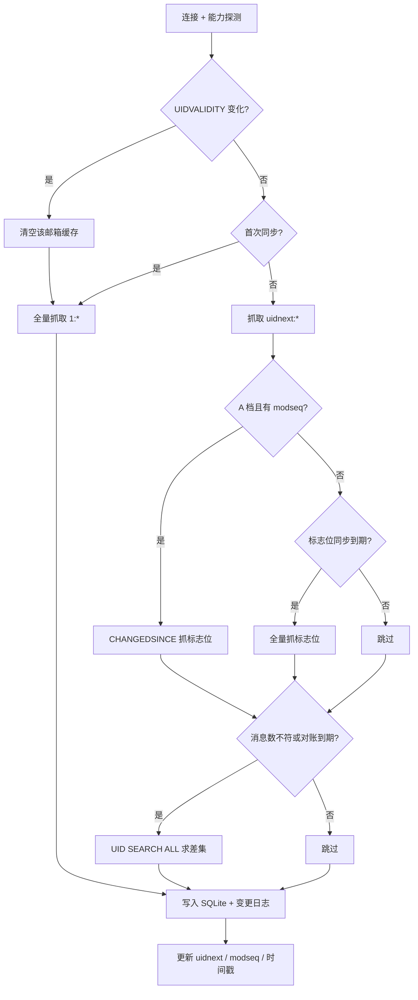

# 实现说明（同步内核 + 加密库 + 多协议 + 正文）

日期：2026-10-29
范围：工程骨架、本地存储（SQLCipher 加密）、凭据保险箱、IMAP/POP3 接收、SMTP 发送、提供商预设、正文/附件按需拉取与 HTML 净化、开发 CLI
状态：协议路径已实测（Dovecot + 88 服务器 STARTTLS）；正文与附件对 Dovecot 实跑；真实账号收发未验收

---

## 1. 已交付

| crate | 职责 | 关键点 |
|---|---|---|
| `mail-crypto` | 凭据保险箱 + 信封加密 | 系统钥匙串（macOS Keychain / Windows Credential Manager / Linux Secret Service）；XChaCha20-Poly1305 带 AAD；主密钥首次使用时生成并存入钥匙串，HKDF-SHA256 派生用途子密钥 |
| `mail-store` | SQLite 存储（SQLCipher） | 账户、邮箱、消息、位置、变更日志、FTS5；内容寻址 `blobs` + 引用计数；`message_parts`/`attachments` 与 `body_state`；WAL；schema 版本迁移；UIDVALIDITY 重建；打开时先验密钥，错密钥与明文旧库都显式报错 |
| `mail-parse` | MIME 解码与净化 | 传输编码（base64/quoted-printable）、charset（encoding_rs，含 GBK）、RFC 2047 文件名、ammonia 白名单净化、HTML→纯文本、整封 MIME 遍历（POP3 路径） |
| `mail-proto` | IMAP/POP3/SMTP 传输 | IMAP：TLS/STARTTLS/明文、能力探测、三档、UID 抓取、BODYSTRUCTURE + `BODY.PEEK` 分段取正文、IDLE、MOVE；POP3：LIST/UIDL/TOP/RETR、STLS；SMTP：EHLO、STARTTLS、AUTH、DATA |
| `mail-sync` | 增量同步 | IMAP：首同步、UID/标志位增量、删除检测、UIDVALIDITY 重建；POP3：UIDL 镜像与轮询 |
| `mail-core` | 门面 | 账户添加、预设解析、IMAP/POP3 分派、`watch`、`check`、`send`（SMTP + Sent 归档）、`fetch_body`（缓存优先）、`fetch_attachment`（按需） |
| `mail-cli` | 开发工具 | `add-account / check / send / accounts / sync / watch / list / body / attachment / stats / export-key / import-key` |

产品 UI、Hub、日历、翻译不在本段范围内。

---

## 2. 同步流程



删除检测不再每次全量扫描：只有服务端 `EXISTS` 与本地条数不一致，或距上次对账超过 15 分钟，才执行 `UID SEARCH ALL`。实测把一次删除同步从 3.4 s 降到 69 ms。

---

## 3. 协议、端口与安全

| 服务 | IMAP TLS | IMAP STARTTLS | POP3 TLS | POP3 STLS | SMTP TLS | SMTP STARTTLS |
|---|---|---|---|---|---|---|
| Gmail | 993 | 143 | 995 | 110 | 465 | 587 / 25 |
| QQ | 993 | 143（服务器不提供 STARTTLS） | 995 | 110（无 STLS） | 465 | 587 / 25 |
| 88 / 111 / email.cn | 993 | 143 | 995 | 110 | 465 | 587 / 25 |
| 自定义 | 用户指定 | 用户指定 | 用户指定 | 用户指定 | 用户指定 | 用户指定 |

- `--provider gmail|qq|88|custom` 决定主机；`--protocol imap|pop3` 决定接收协议；`--security tls|starttls|plaintext` 决定加密方式；`--port/--smtp-port` 可覆盖默认端口。
- 默认端口由协议与安全方式推导（IMAP 993/143、POP3 995/110、SMTP 465/587）。
- 明文必须显式开启：`--security plaintext` 或 `--smtp-security plaintext` 需要同时提供 `--insecure-plaintext true`，否则拒绝写入账户。
- QQ 的 143/110 不提供 STARTTLS/STLS，使用这两个端口即明文传授权码；文档与错误信息会提示改用 993/995。
- 发信为纯文本 UTF-8（base64 正文）；IMAP 账户发送成功后尝试追加到 `Sent`（`--sent-mailbox` 可改），失败只报告 `save_error`，不回滚投递；POP3 无 Sent 归档。

---

## 4. 实测结果（Dovecot 2.3.19，10,000 封）

| 场景 | 结果 |
|---|---|
| 首次全量同步（release） | 10,002 封 / **1,005 ms**，数据库 5.1 MB |
| 加密库首次全量同步（release） | 10,003 封 / **612 ms**，数据库 5.7 MB |
| 加密库空闲增量 | **1 ms**（同步阶段） |
| 无密钥打开 | `sqlite3 … 'select count(*) from sqlite_master;'` → `file is not a database`（26）；`strings` 无主题命中 |
| 错密钥打开 | `StoreError::WrongKey`（单测覆盖） |
| 明文旧库打开 | `StoreError::PlaintextDatabase`（单测覆盖；CLI 实跑同结果） |
| 空闲增量（release） | **5 ms**（进程整体 38 ms） |
| 新邮件经 IDLE 到达并同步 | **43 ms**（含通知与写入） |
| 标志位变更（CHANGEDSINCE） | applied=1，无重复插入 |
| 外部删除一封 | removed=1，**69 ms** |
| UIDVALIDITY 重建 | 清空后全量 10,000 封 / 2,794 ms（debug 构建） |
| STARTTLS（88：IMAP 143 / POP3 110 / SMTP 587） | 升级后进入 AUTH，错误口令被拒 |
| POP3 同步（mock） | 2 封入库；UIDL 消失后 removed=1 |
| SMTP（mock） | AUTH PLAIN、MAIL/RCPT/DATA、点填充校验通过 |
| 正文拉取（multipart/alternative + 附件，Dovecot） | 首次取正文 1 次连接，`state=partial`；附件下载后 `state=full` |
| 正文二次打开（服务器已停） | **39 ms** 进程整体，纯本地缓存命中 |
| 单部件消息（`BODY.PEEK[TEXT]`） | 正常取回，`state=full` |
| 附件按需下载（base64） | 解码后内容与原文一致；`blob_bytes` = 正文 + HTML + 附件之和 |
| 重同步后正文缓存 | 保留，`body_state` 不回退 |
| 单测 | 66 个全绿（crypto/store/sync/proto/parse/core） |

首次同步后进程启动有一次钥匙串授权检查（新二进制），之后的同步都在 40 ms 内。

---

## 5. 正文与附件

- 同步阶段只写头部，`body_state='headers'`；打开邮件时才拉正文，二次打开只读本地库。
- IMAP：`FETCH (UID BODYSTRUCTURE)` → 叶子部件按 `1`、`2.1` 编号 → 只对正文部件发 `BODY.PEEK[<section>]`（不置 `\Seen`）；附件留到用户点下载。
- POP3：无分段，`RETR` 整封 → `mail-parse` 遍历 MIME → 正文与附件一次入库。POP3 的正文部件键固定为 `text`/`html`，不伪装成 IMAP section。
- 解码：`mail-parse` 处理传输编码与 charset（含 GBK）；HTML 经 ammonia 白名单净化，`script/iframe/form/style` 移除，`url(...)` 与 `javascript:` 丢弃，远程图片改 `about:blank`，只放行 `cid:` 与光栅 data URI。
- 存储：`blobs` 按 sha256 内容寻址 + 引用计数；`message_parts` 存已解码 UTF-8 正文；`attachments` 存元数据（含传输编码），下载后回填 `blob_hash`；`body_state` 由 `refresh_body_state` 统一推导：`headers` → `partial` → `full`。
- 附件文件名统一取 basename、剥离控制字符、解码 RFC 2047、截断 255 字符；不自动打开（隔离目录导出待 UI 段）。

---

## 6. 运行方式

```bash
# 1) 测试服务器（脚本见 docs/SPIKE-REPORT.md）
docker start mail-spike-dovecot

# 2) 测试账户（Dovecot 明文，必须显式允许）
cargo run -p mail-cli -- --db /tmp/mail.db add-account \
  --email vmail@example.com --host 127.0.0.1 --port 31143 \
  --security plaintext --insecure-plaintext true \
  --username vmail --password testpass

# 3) 提供商预设（密码/授权码从 stdin 读）
printf 'app password: ' >&2
read -rs APP_PW
printf '%s\n' "$APP_PW" | cargo run -p mail-cli -- --db /tmp/mail.db add-account \
  --provider gmail --email you@gmail.com --security tls --password-stdin
unset APP_PW

# QQ：授权码；88：专用密码；自定义：显式 --host/--smtp-host
# 接收协议可选 imap/pop3；安全方式 tls/starttls/plaintext

# 4) 验证登录与发信
cargo run -p mail-cli -- --db /tmp/mail.db check --email you@gmail.com
cargo run -p mail-cli -- --db /tmp/mail.db send --email you@gmail.com \
  --to peer@example.com --subject hello --body 'plain text body'

# 5) 同步与查看
cargo run -p mail-cli -- --db /tmp/mail.db sync --email vmail@example.com
cargo run -p mail-cli -- --db /tmp/mail.db stats --email vmail@example.com
cargo run -p mail-cli -- --db /tmp/mail.db list --email vmail@example.com --limit 20

# 5.1) 正文与附件（id 取自 list 的 id= 列；--html true 输出净化后的 HTML）
cargo run -p mail-cli -- --db /tmp/mail.db body --email vmail@example.com --id 42
cargo run -p mail-cli -- --db /tmp/mail.db attachment --email vmail@example.com \
  --id 42 --part 2 --out /tmp/report.pdf

# 6) 常驻监听（收到新邮件即增量同步）
cargo run -p mail-cli -- --db /tmp/mail.db watch --email vmail@example.com

# 7) 验证加密：首次打开会自动在主密钥条目下生成密钥
sqlite3 /tmp/mail.db 'select count(*) from sqlite_master;'   # 期望 file is not a database
strings /tmp/mail.db | grep -c 'Subject'                     # 期望 0

# 8) 主密钥备份 / 恢复（输出即密钥本身，存进密码管理器）
cargo run -p mail-cli -- --db /tmp/mail.db export-key
cargo run -p mail-cli -- --db /tmp/mail.db import-key --value '<base64>'          # 相同则不改动
cargo run -p mail-cli -- --db /tmp/mail.db import-key --value '<base64>' --force true
# import-key 会用 --db 指向的库验证密钥：打不开就失败，不覆盖钥匙串

# 9) 测试
cargo test --workspace
```

---

## 7. 已知缺口（按优先级）

1. **仅支持密码/应用专用密码认证**。Outlook 需 OAuth2 应用身份，按 2026-10-29 范围决策不接；Gmail 走应用专用密码（待真实账户验证）。
2. **只同步 INBOX**。`mail-proto` 已能列出邮箱，门面尚未遍历；特殊文件夹角色映射已就绪。
3. **正文未进 FTS**。正文已按需拉取并解码，但全文索引仍只覆盖主题/发件人/收件人/摘要；把 `body_text` 并入 FTS 需要重建索引的迁移。
4. **B/C 档未实跑**。代码路径已实现，但没有 iCloud 等 C 档测试账户；能力矩阵来自未登录探测。
5. **变更日志会持续增长**。全量同步会为每封邮件写一条变更记录，需要压缩/快照机制（Hub 上线前必须做）。
6. **中文 1–2 字搜索走 LIKE 扫描**。10 万封以内可接受，更大规模需要专门的分词索引。
7. **重连退避未做故障注入**。逻辑在 `Core::watch` 中，但未模拟断网/服务器重启。
8. **POP3 语义受限**。无文件夹/标志位/IDLE；UIDL 以 63 位哈希映射为数字 uid；服务器删除通过 UIDL 消失检测。
9. **发信能力窄**。仅纯文本；无附件、HTML、草稿；Sent 归档只在 IMAP 尝试，失败仅告警。
10. **真实账号未验收**。QQ/88/Gmail 的同步与发信需要授权码/专用密码。
11. **主密钥无轮换与自动备份**。`export-key`/`import-key` 支持人工备份到密码管理器，但主密钥仍只有钥匙串一份，且库密钥不能在线轮换。

---

## 8. 下一段建议

按依赖顺序：

1. 多邮箱遍历与特殊文件夹映射
2. 发信补齐：HTML、附件、草稿与 Sent 去重
3. FTS 正文索引（`body_text`）与中文索引策略、变更日志压缩
4. 主密钥导出/恢复与库密钥轮换
