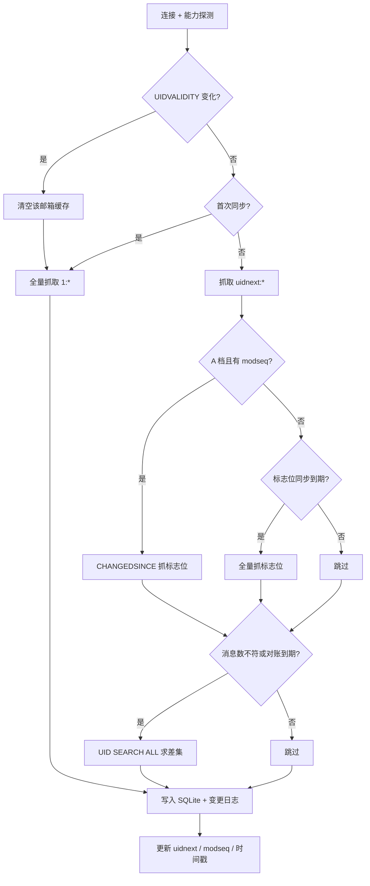

# 第一段实现说明（同步内核）

日期：2026-10-29
范围：工程骨架、本地存储、凭据保险箱、IMAP 同步内核（三档策略）、开发 CLI
状态：已实现并在 Dovecot 上实跑验证

---

## 1. 已交付

| crate | 职责 | 关键点 |
|---|---|---|
| `mail-crypto` | 凭据保险箱 + 信封加密 | 系统钥匙串（macOS Keychain / Windows Credential Manager / Linux Secret Service）；XChaCha20-Poly1305 带 AAD；主密钥首次使用时生成并存入钥匙串 |
| `mail-store` | SQLite 存储 | 账户、邮箱、消息、位置、变更日志、FTS5；WAL；schema 版本迁移；UIDVALIDITY 重建 |
| `mail-proto` | IMAP 传输 | 隐式 TLS、能力探测、三档判定、UID 范围抓取、CHANGEDSINCE、IDLE、MOVE / COPY+删除回退 |
| `mail-sync` | 增量同步 | 首同步、UID 增量、标志位增量、删除检测、UIDVALIDITY 重建、合并去重 |
| `mail-core` | 门面 | 账户添加（密码入钥匙串）、连接、单次同步、常驻 IDLE 循环与退避重连 |
| `mail-cli` | 开发工具 | `add-account / accounts / sync / watch / list / stats` |

产品 UI、Hub、日历、翻译不在本段范围内。

---

## 2. 同步流程



删除检测不再每次全量扫描：只有服务端 `EXISTS` 与本地条数不一致，或距上次对账超过 15 分钟，才执行 `UID SEARCH ALL`。实测把一次删除同步从 3.4 s 降到 69 ms。

---

## 3. 实测结果（Dovecot 2.3.19，10,000 封）

| 场景 | 结果 |
|---|---|
| 首次全量同步（release） | 10,002 封 / **1,005 ms**，数据库 5.1 MB |
| 空闲增量（release） | **5 ms**（进程整体 38 ms） |
| 新邮件经 IDLE 到达并同步 | **43 ms**（含通知与写入） |
| 标志位变更（CHANGEDSINCE） | applied=1，无重复插入 |
| 外部删除一封 | removed=1，**69 ms** |
| UIDVALIDITY 重建 | 清空后全量 10,000 封 / 2,794 ms（debug 构建） |
| 单测 | 12 个（crypto 3、store 6、sync 3）全绿 |

首次同步后进程启动有一次钥匙串授权检查（新二进制），之后的同步都在 40 ms 内。

---

## 4. 运行方式

```bash
# 1) 测试服务器（脚本见 docs/SPIKE-REPORT.md）
docker start mail-spike-dovecot

# 2) 添加账户：密码写入系统钥匙串，数据库只存引用
cargo run -p mail-cli -- --db /tmp/mail.db add-account \
  --email vmail@example.com --host 127.0.0.1 --port 31143 --tls false \
  --username vmail --password testpass

# 3) 同步与查看
cargo run -p mail-cli -- --db /tmp/mail.db sync --email vmail@example.com
cargo run -p mail-cli -- --db /tmp/mail.db stats --email vmail@example.com
cargo run -p mail-cli -- --db /tmp/mail.db list --email vmail@example.com --limit 20

# 4) 常驻监听（收到新邮件即增量同步）
cargo run -p mail-cli -- --db /tmp/mail.db watch --email vmail@example.com

# 5) 测试
cargo test --workspace
```

---

## 5. 已知缺口（按优先级）

1. **数据库未加密**。凭据已进钥匙串，但邮件元数据与正文仍是明文 SQLite。下一步切 `rusqlite` 的 `bundled-sqlcipher`，密钥同样存钥匙串。这是本段唯一的**安全缺口**。
2. **只有 LOGIN 认证**。Outlook 已禁用密码登录（`LOGINDISABLED`，仅 `AUTH=XOAUTH2`），当前会连接失败。需要补 XOAUTH2 与 OAuth2 + PKCE 流程，以及 STARTTLS。
3. **只同步 INBOX**。`mail-proto` 已能列出邮箱，门面尚未遍历；特殊文件夹角色映射已就绪。
4. **只取头部**。正文、附件按需拉取尚未实现（`body_state` 字段已预留）。
5. **B/C 档未实跑**。代码路径已实现，但没有 Outlook/iCloud 测试账户；能力矩阵来自未登录探测。
6. **变更日志会持续增长**。全量同步会为每封邮件写一条变更记录，需要压缩/快照机制（Hub 上线前必须做）。
7. **中文 1–2 字搜索走 LIKE 扫描**。10 万封以内可接受，更大规模需要专门的分词索引。
8. **重连退避未做故障注入**。逻辑在 `Core::watch` 中，但未模拟断网/服务器重启。

---

## 6. 下一段建议

按依赖顺序：

1. SQLCipher + 数据库密钥轮换（补齐安全基线）
2. XOAUTH2 + OAuth2 PKCE（解锁 Gmail / Outlook）
3. 正文与附件按需拉取 + HTML 净化接入（复用 spike 的净化器）
4. 多邮箱遍历与特殊文件夹映射
5. FTS 中文索引策略与变更日志压缩
